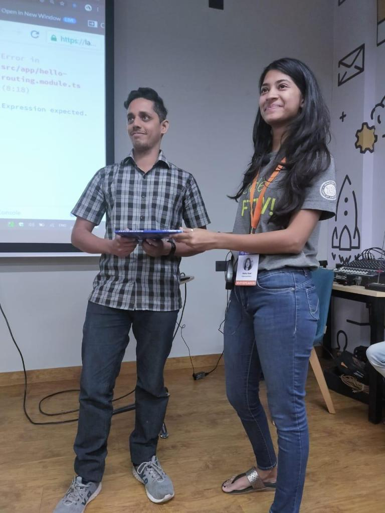


2020 started with the first Angular event on 25th of January of the year. This event, Trivandrum TechCon20 was organised as a part of 2020 twenty series in Thiruvananthapuram, Kerala, India.

The event included multiple talks about Azure, .NET, Flutter, cognitive services from some great speakers. I spoke about the Angular Router and its lifecycle at the event.

My presentation included code examples and to make the session interactive and less monotonous, I used those code examples to be able to turn the monologue into a discussion and more of a fun way of understanding the topic.

So, the three code examples that I shared in the presentation had to be fixed by somebody from the attendees and the one able to crack the bug and solve the code problem would get a goodie. This helped in really interacting with the developers of the city. The code examples were as simple as just a ?<router-outlet> misplaced or not placed at all, for example.

By the end of the talk, the idea was to see if anybody was introduced to the new syntax for lazy loading i.e., dynamic imports for lazy loaded routes. One of the attendees who could write the lazy loading syntax from Angular 8, was awarded with the book **[‘Step-by-step Angular Routing](https://www.amazon.in/Step-Angular-Routing-Nishu-Goel/dp/9388511662/)**‘.

---

The references to the talk as in the slides, code examples are shared here:

SLIDES: <https://speakerdeck.com/nishugoel/the-angular-router-trivandrumtechcon20>

**STACKBLITZ CODE EXAMPLES**

**Wildcard Route Order:** <https://stackblitz.com/edit/routingwildcardorder>

**Router Events:** <https://stackblitz.com/edit/routerevents>

**Lazy load Routes:** <https://stackblitz.com/edit/lazyloadroutes>

Read more blog posts around the concepts of Angular here:

https://nishugoel.wordpress.com/

