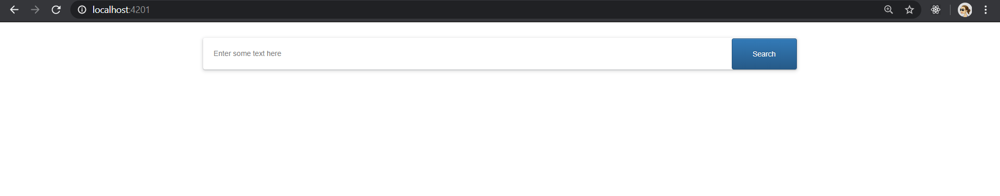
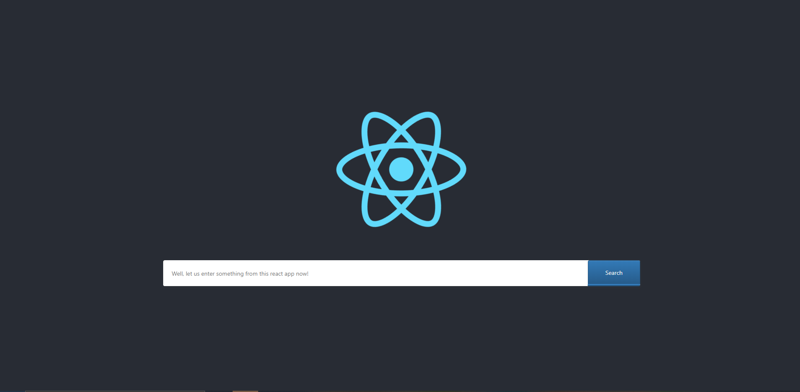
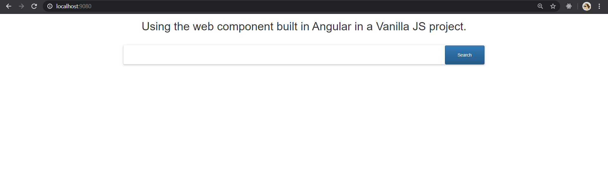


### **Link to Code Lab:** [**https://ng-codelab-webcomponents.netlify.com**](https://ng-codelab-webcomponents.netlify.com)

In this small blog post, I’ll walk through the **code lab** I created for learning how to create web components using Angular Elements, understanding the different web component specifications, and then being able to use them in some other frameworks.

In the month of February, I will be speaking at two conferences about “Framework-agnostic web components in Angular” for some 25–30 mins each. However, for the real understanding of the topic and being able to implement what’s being talked about, the audience needs more.

Subscribing to this, I chose to create a small code lab kind of an activity. This code lab will discuss the things important to know to be able to create custom elements using Angular Elements and be able to use those in other framework projects, or vanilla JS projects too.

### The contents that this **code lab** contains are:

* an overview of what we will implement moving forward.
* pre-requisites for creating custom elements
* setting up the development environment
* understanding the web component specifications
* an overview of what are Angular elements
* creating custom elements using Angular elements
* building the web component to be able to use it externally
* publishing the bundle to npm registry
* using the web component in a React project

The code lab already links to the two repositories containing the source code for an Angular project in which the Angular element is created & bundled and a React project with the code for using this web component after installing from npm.

### Created Web component

### Usage of the web component in React

### Usage of the web component in a JavaScript project

### **Repositories**

* **Web component using Angular Element**

> <https://github.com/NishuGoel/frameworkAgnostic-searchBar>

* **Using the custom element in React**

> <https://github.com/NishuGoel/useAngularElementinReact>

* Using the custom element in a vanilla JavaScript project

> <https://github.com/NishuGoel/useWebCompInVanillaJS>

