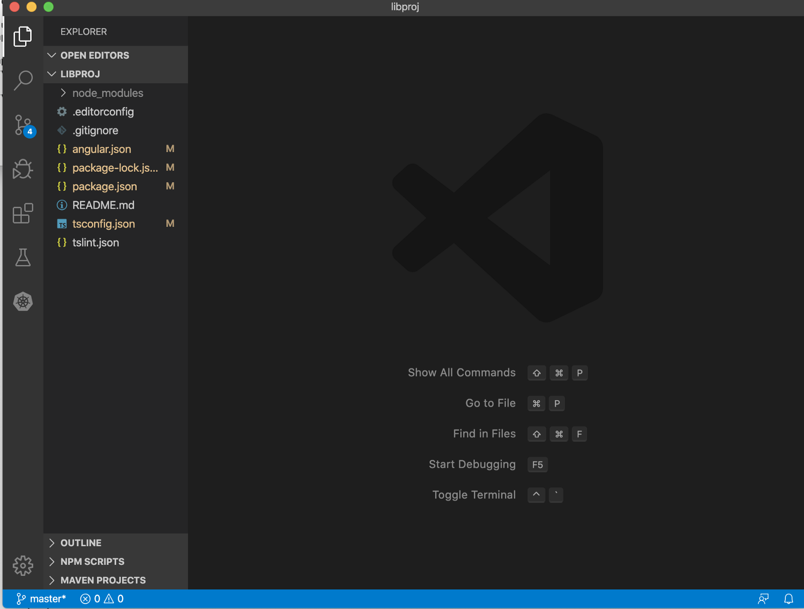
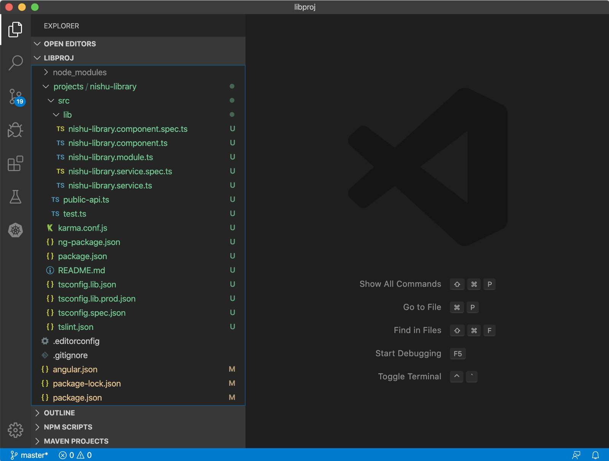
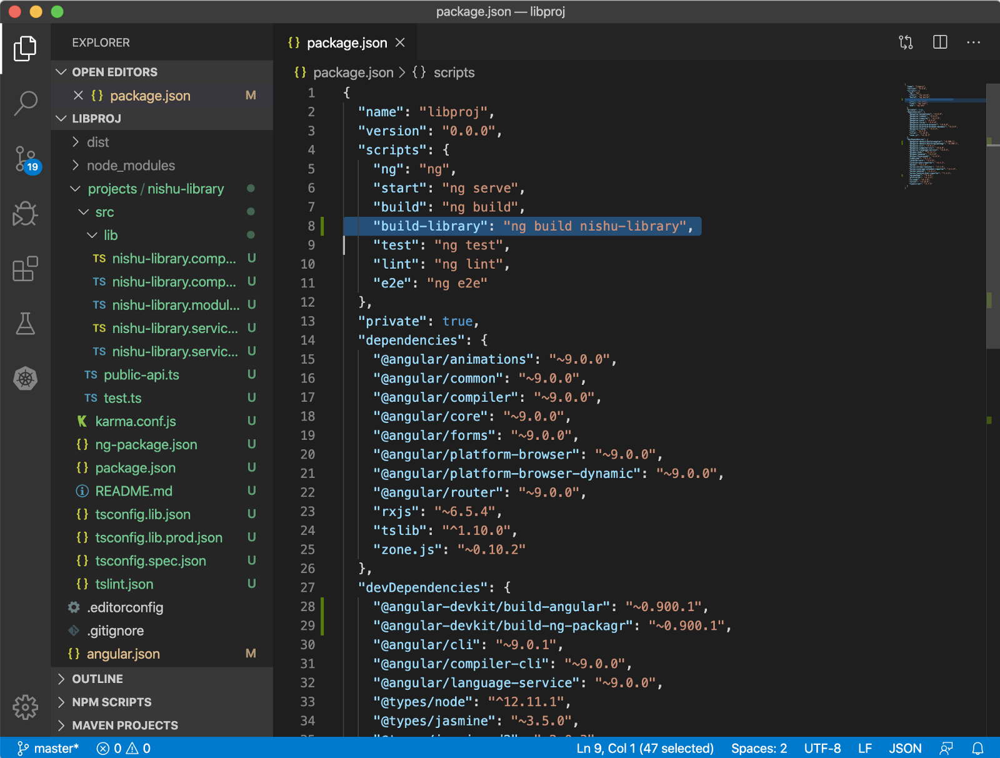
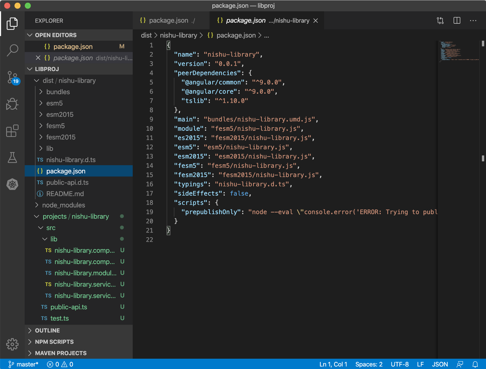
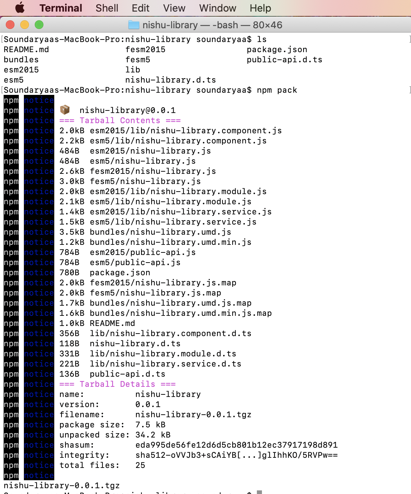
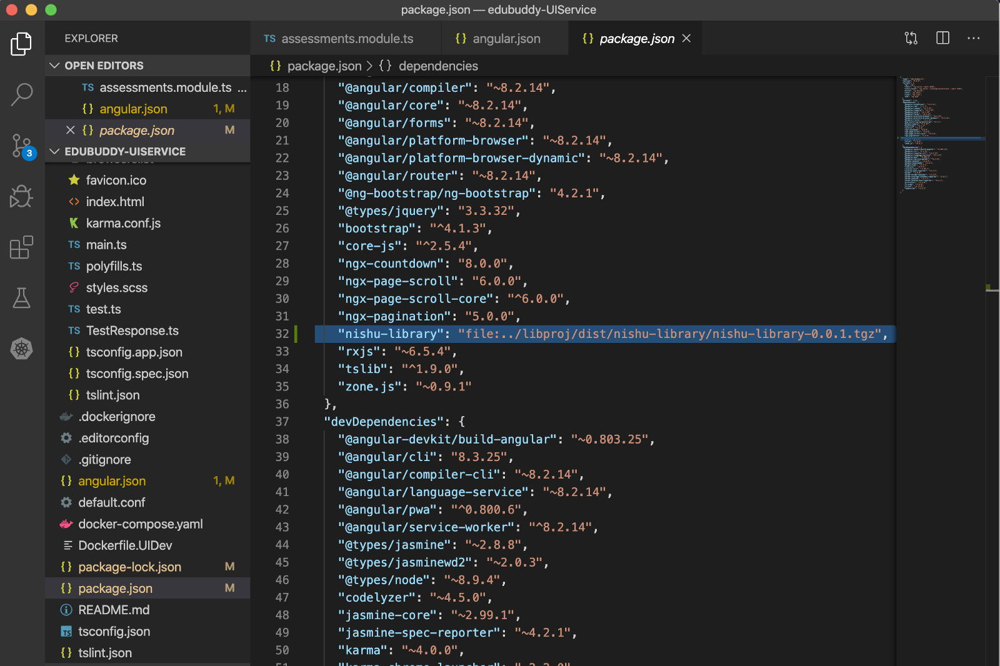
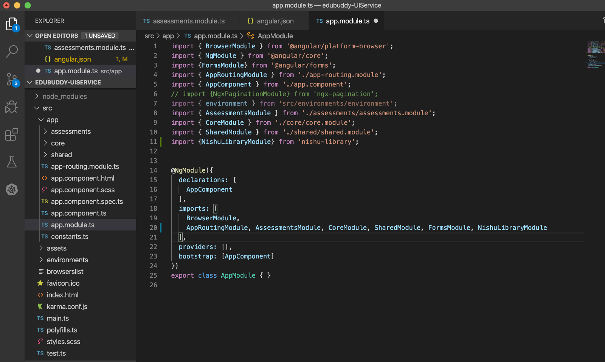
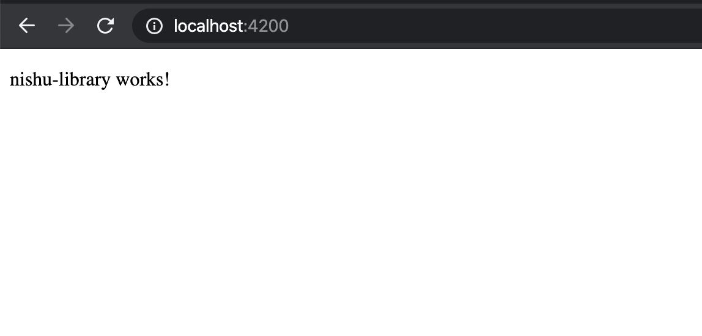
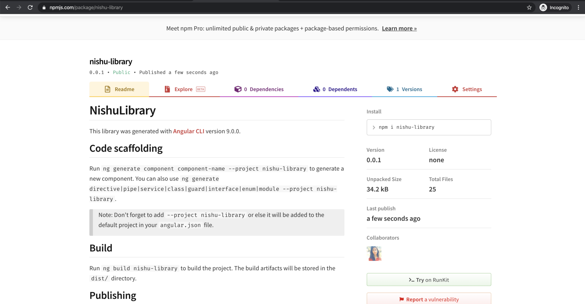


I was working on a library project and I realised having never really documented anywhere about the step by step creation of an angular library, both for my later reference and for you all. So, here I go!

Before I start this blog post, I want to convey about an angular library codelab that I am working on to explain all the possible errors we might run into when creating our libraries using Angular. This code lab will be a step by step guide to creating libraries using the CLI. This codelab will be a detailed cookbook and you can simply follow the same to be able to create a library.

In this blog post, I will talk about the overview of libraries, creating a library, using it locally in an angular application, publishing it to npm.

**Creating** **a library**: [https://github.com/NishuGoel/ngSLDemo](https://github.com/NishuGoel/ngSLDemo.git)

**Consuming the library:** https://github.com/NishuGoel/consuming-angular-lib

### Overview

Firstly, let us understand what a library generally in programming means.

A library is a collection of precompiled routines that a program can use. Let us break this definition down to understand better.

**Pre-compiled routines –**hints that it is a compiled, established, ready-to-serve version of some task that is to be performed repeatedly.   
**that a program can use –**hints that this reusability can be leveraged across multiple different projects, not necessarily the project where the library is created.

Putting it all together, a library is majorly a set of functionality that is relevant enough to be used in multiple projects and a compiled version of it is bundled and presented to whichever project needs it. The features of a library therefore are,

* shareable code
* reusable functionality
* separate dedicated code for one feature

An Angular library contains components, modules, services to define the functionality. We already use so many libraries in our apps for features like a countdown timer, or maybe a scroll bar. If you have some functionality which you see getting used frequently, why not export it as a library and use it. Think of it as an Angular application with linkages to many Angular/Javascript libraries.

### What a library should be to qualify to be an Angular library?

* platform independent, first of all
* bundled and distributed
* AOT compilation ready
* built in typescript

Now for a library to be standard and be easily consumed by everyone, there must be a standard or a recommended way to how you should distribute your package.

**Angular package format** is that recommended way to distribute our Angular packages. This focuses on the following:

* Module definitions
* Typing files
* Entry point
* AOT ready metadata file

Read the APF [**here**](https://docs.google.com/document/d/1CZC2rcpxffTDfRDs6p1cfbmKNLA6x5O-NtkJglDaBVs/preview)**.**

### Creating a library

the important steps involved in creating a library majorly are inlining all the templates, compiling it with ngc, and producing its build formats. However, this is a lot of manual tasks and ng-packagr has got us covered to do just that.

I have written about using ng-packagr to create libraries [**here**](https://medium.com/swlh/angular-library-with-ng-packagr-13f20ed202bd)**.**

**ng-packagr** created by David Herges, allows libraries to be build and packaged using a single command. However, after Angular 6, this is integrated within the CLI and we can use ng generate command to create an angular library with ng-packagr working under the hood.

**What all does ng-packagr take care of for us?**

* creates libraries in the angular package format
* creates all the bundles (es52015, esm5, umd)
* creates type definitions (.d.ts)
* create aot metadata files
* inlines all the styles and templates!

Let us create a workspace for our library!

`ng new <application-name> --create-application=false`



This would create a workspace for you with no src folder as you haven’y created the application and just a workspace and under which we can create our library using the command:

`ng generate library <library-name>`

This creates a projects folder with your lib folder inside it. Here you can start writing the feature you want for your library!



done creating your library?

### Time to build our library!

Add a build library script in your root package.json as:

`"build-library": "ng build nishu-library”`



Running this would create a dist folder for your library.



Here is when your project becomes a bit difficult to understand. why? because if you notice now your whole project contains 3 package.json files in all. The root package.json where you wrote your build library script, the library package.json which provides the information for your library such as name, version. This is used when publishing your library to npm. I will talk about it when packaging the library.  
the third package.json is in the distribution folder of the library that you just created which is the final code to be exported.

### Packaging the library

To pack our library, we go to the library distribution directory and run the npm pack command.

Avoid the confusion here of packing the library directory. We need to pack the built distribution folder of the library. We can add a script also in place of doing this manually.

`"pack-lib": "cd dist/nishu-library && npm pack"`

This would create a .tgz package for the library which is to be exported into other applications we will be using.



With our package ready, we can use it inside another application to consume it and test.

Create a new angular application and install your library inside this using:

`npm install <path-to-tgz-file>`

Check your package.json to see if it has installed and is reflecting isnide the dependencies.

You will notice it being added as a file just like this:



Next step, import the module of your library, and use the component.

`import { NishuLibraryModule} from 'nishu-library';`

This should give our project the access to the components declared inside thsi module. We can now use the component directly on the template and see how it works!



On the template,

```
<section class="body-section">
    <lib-nishu-library></lib-nishu-library>
</section>
```

And there you go!



### Finally, let us publish our library

To publish your library, follow the naming conventions for an npm package and to keep it unique since there are so many libraries on npm, an easy way is to name your library as `@<your-username>/<library-name` .

Next step, specify the name and version of the library inside the package.json

```
{
  "name": "nishu-library",
  "version": "1.0.0",
  "peerDependencies": {
        "@angular/common": "~9.0.0",
        "@angular/core": "~9.0.0",
  }
}
```

peerDependencies basically are a way to tell the consuming project that the library is well compatible with this version of the package. Use semantic versioning to version your library following the major, minor, patch version specifics. Read about SemVer [**here**](https://semver.org/)**.**

There is a lot more information that you can add to your package.json about the library like author, license etc.

Build your library and find the updated package.json in the dist folder. Pack the new bundle as we did before using the `pack-lib` script.

All set? Let us login to npm.We can do this both from the command line or the GUI.

> npmjs.com

Log in to npm using `npm login` and verify using `npm whoami`

Publish your library using the npm publish command with the path to your tgz bundle.

`npm publish dist/nishu-library/nishu-library-0.0.1.tgz --access public`

Head over to npmjs.com and you can have a look at your published library.



Well, now anybody can use this publicly available library in their Angular projects using:

`npm i nishu-library`

Thank you for reading!   
Please reach out to me on Twitter/LinkedIn for feedback/queries.

