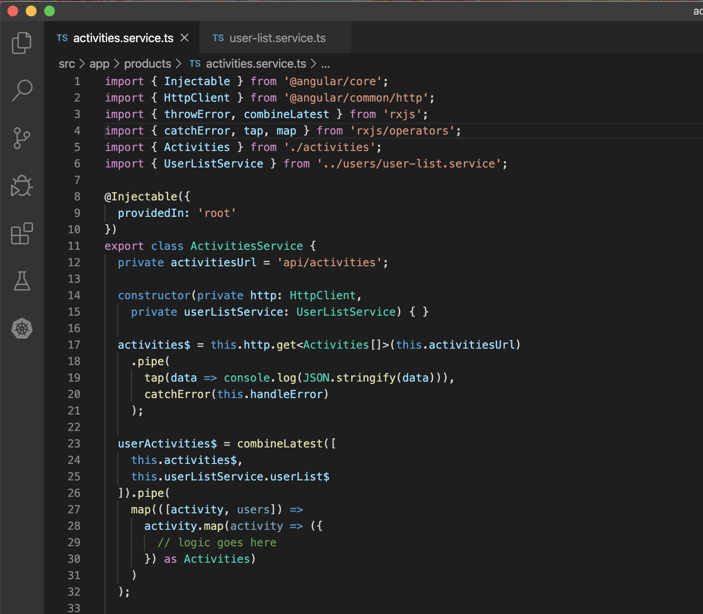
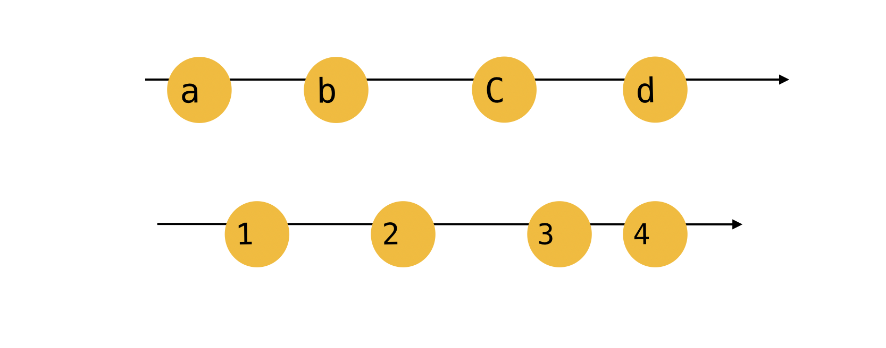
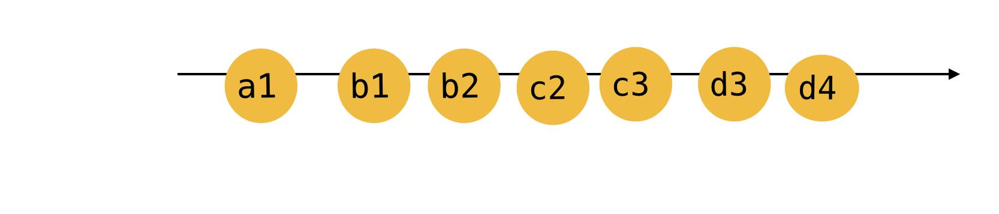
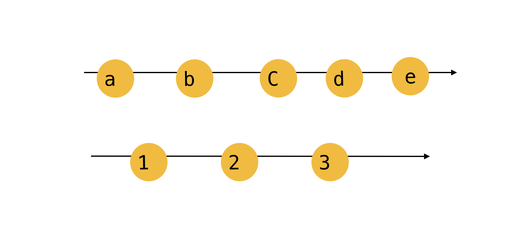
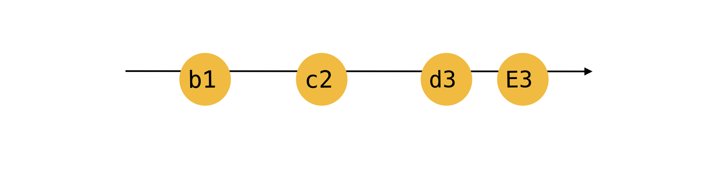


In this blog post about understanding the usage of these three combination operators and handling errors with these, I will cover:

* What are combination operators in RxJS
* use cases for three of these
* handling errors when using combination operators

# Introduction to why combination operators

When working with data streams, we might want to combine multiple data streams into one stream to be able to get one result in some scenarios. You might be wondering why would you want to combine two data streams containing different data information, at all.

Well, think of a some associated data coming through different streams, for example, one activity list stream whereas the other stream of the different platforms where a particular activity is performed. These when combined together, might end up giving you concrete data to be presented to the user.

The different types of combination operators can be first, the ones joining data from multiple streams to one stream; second, the ones like mergeAll, which merge together all the values to create one stream; third, and the one we will have our focus on in this blog post, are which combine data from different streams and emit a stream of combined values.

# Now you might be wondering that…

If the data streams are combined, how would you effectively perform error handling? This means, if let us say three data streams are combined and one throws an error while the other two are successful, how would you handle such a scenario. Too complicated, wouldn’t it be?

I also thought so but it is not that complicated as it seems to be. More on that later.

In this blog post, I will cover three majorly used combination operators in production level applications.

* combineLatest
* forkJoin
* withLatestFrom

# combineLatest

The combineLatest operator is one of the combination operators that emits the last value from each of the observable streams when the observable emits a value.

**Example**, if there are 3 data streams passed as an argument to the combineLatest operator, it will take the latest emitted value by each of the argument streams in that particular order.

You won’t see the result until each of the streams have emitted at least one value. This means if you have passed in 2 argument observables to the operator, the returned observable will always emit an array of 2 values. Now since the resulting array needs to have the same length, the combineLatest operator emits only once each of the streams have emitted at least once.

Wondering what happens if one of the observable didn’t complete? Well, the output observable won’t complete too in that case since it waits for all the input streams to emit a result.

Read about the `project` function of the combineLatest operator [**here**](https://rxjs.dev/api/index/function/combineLatest).

# Example

```
this.usersActivities$ = combineLatest([
    this.activities$,
    this.userslist$
])
```

Defining the known observables as arguments to the combineLatest operator.

`combineLatest(action$, objects$)`

Always a better idea to use an array of observables so that if needed to add more input observables, you can add them in the array.

`combineLatest([action$, object$])`



# forkJoin

When the observable emits only one value or you want only the last value from each stream, that is when forkJoin proves to be of help.  
forkJoin allows creation of the output stream with the last values from all the input streams.

Think of it as the last decision to be made about something to be able to proceed with the same, instead of jumping to conclusions with every input from a stream.

Example use case: When we are dealing with multiple API calls, and do not want to maybe render the view until all the http requests have completed, forkJoin is the right thing to do. However, you might end up in a trouble if you choose to use forkJoin when one of the input streams might not complete.

```
this.usersActivities$ = forkJoin([
    this.activities$,
    this.userslist$
])
```

Now this will wait for all the streams to be completed, and will emit only when both sets of data are returned.

# withLatestFrom

This is a pipe-able operator which creates an output stream with the latest values from the other input streams only once each of the streams have emitted at least one value.

```
this.usersActivities$ = this.activities$
.pipe(
    withLatestFrom(this.userslist$)
);
```

This will until each of the input streams emit at least once and then emits every time the source streams emit

Now I was confused about the difference between the combineLatest operator and the withLatestFrom since both of these emit the latest values. But the point of differences are:

* **combineLatest**, first of all, does not wait for each of the input streams to emit at least one value. **withLatestFrom** only emits once all the input streams have emitted one value each.
* **combineLatest** from emits multiple created fields based on all the input streams including itself. **withLatestFrom**creates a formula with its own value and the latest one from the other streams.

**Still confusing?**

Let us understand better.

**combineLatest**input streams:



**combineLatest**Output stream:



---

**withLatestFrom** Input Streams:



**withLatestFrom**Output stream:



# Error Handling

So, we talked about the case when one of the streams failed in the combination operators, how to handle errors?

Let us take the case of **forkJoin** to understand this!  
Imagine having three input streams, out of which one fails while the other two succeed, what would happen?  
The forkJoin operation FAILS!

As per the documentation,

> “If any input observable errors at some point, forkJoin will error as well and all other observables will be immediately unsubscribed.”

What do we do then!  
So a good idea here can be to not let forkJoin know if there was an error. And handle the errors of each of the input streams individually using catchError.

Finally subscribe to these in  
`forkJoin.subscribe(next=> {})`

Read more about error handling with forkJoin in this interesting article [**here**](https://medium.com/better-programming/rxjs-error-handling-with-forkjoin-3d4027df70fc).

