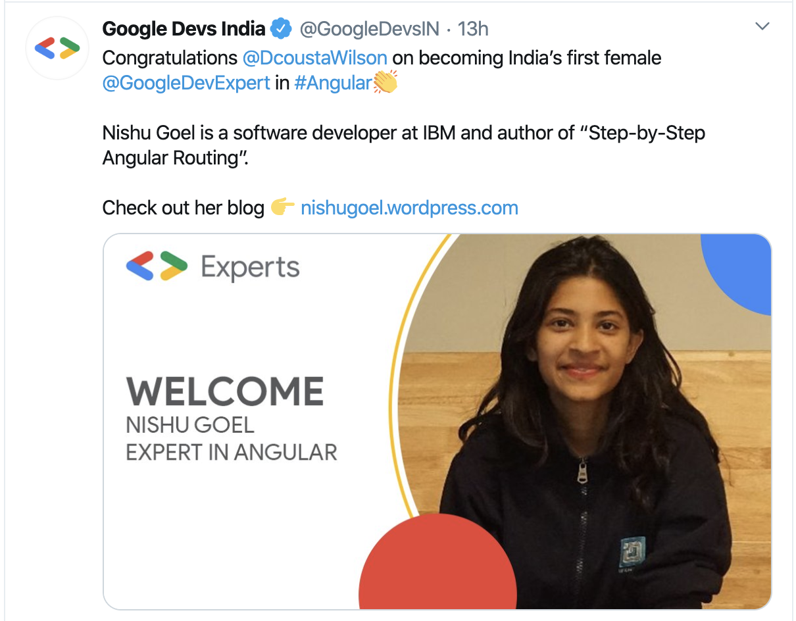
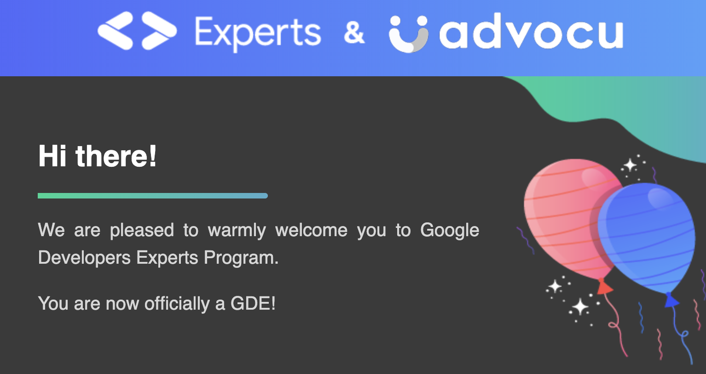
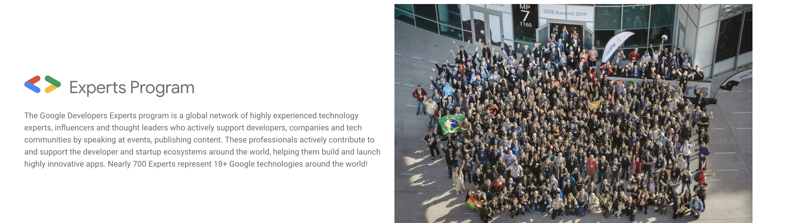
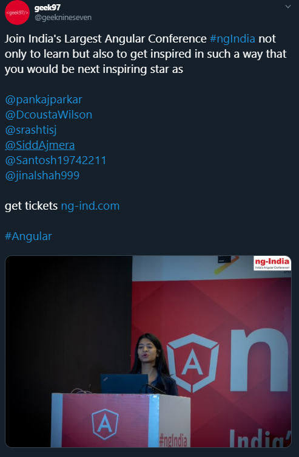
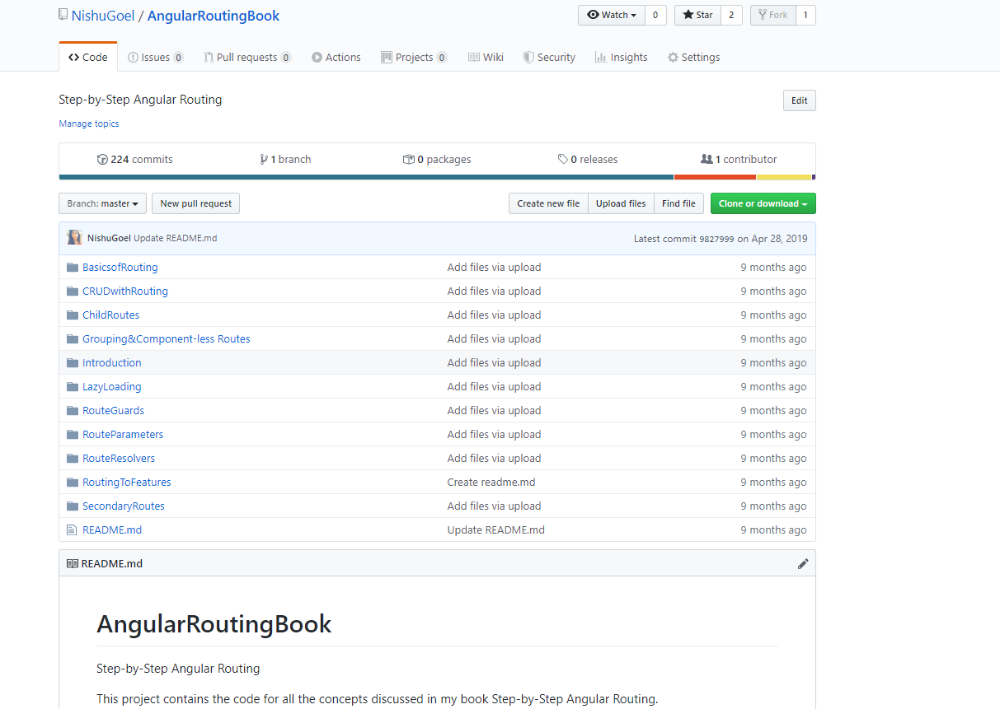
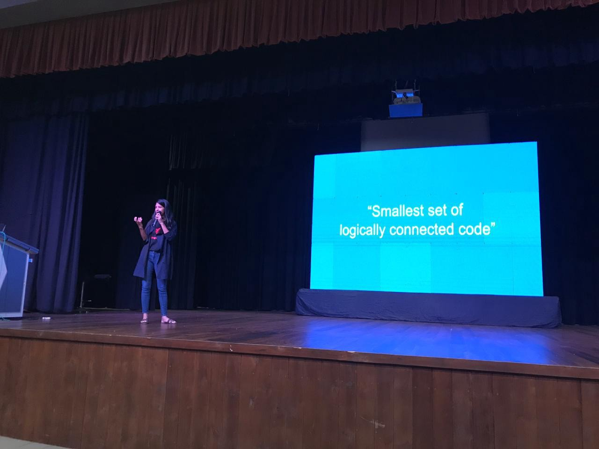
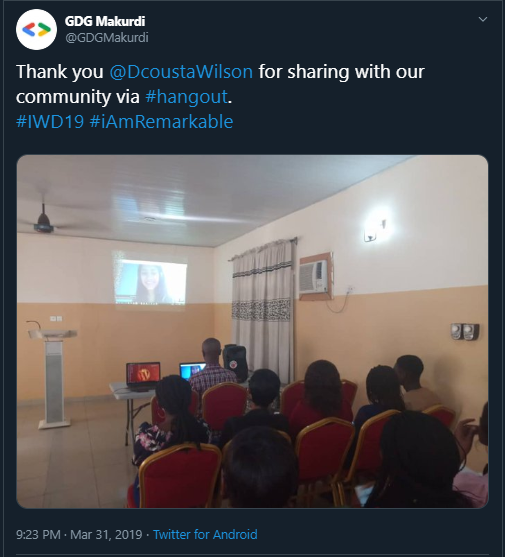
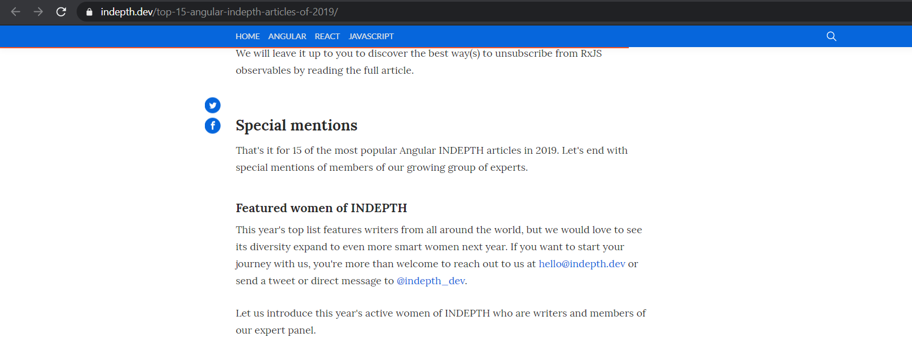
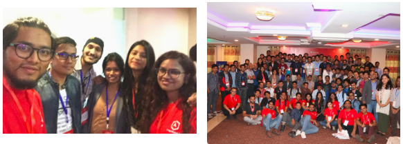



I am very excited to be sharing that I have been recognized as a Google Developer Expert in **Angular**. I am very thankful to everyone who was so supportive in the process.

# What is GDE?

GDE is a program to recognize individuals who are experts in some technology and use their knowledge to contribute to the community and share it with other developers. You can learn more about the program [here](https://developers.google.com/community/experts).

Read more about the process [**here**](https://fluin.io/blog/how-to-become-an-angular-gde).

# How did I contribute?

* I started working in Angular (freelance && full-time) around two years back and diving deeper into the working of the framework.
* I started writing [blog posts](https://medium.com/@nishu0505) around my knowledge after June 2018 when DJ, the organiser told me the importance of writing what we learn to document it and share it with others.
* By the end of 2018, I wrote around 50 blog posts and the number is more than a hundred now. You can read these [**here**](http://nishugoel.wordpress.com/).
* I have created two video courses on Angular, one is available [**here**](https://www.udemy.com/course/angular-for-beginners-l/) and the other [**here**](https://www.c-sharpcorner.com/learn/learn-angular-8-in-25-days).
* I have also created two code labs containing just the right code and issues a developer comes across when creating web components and libraries. Details [**here**](https://medium.com/@nishu0505).
* I wrote a [**book on Routing in Angular**](https://www.amazon.in/Step-Angular-Routing-Nishu-Goel/dp/9388511662) and published it in May 2019.
* I spoke in 11 conferences and meet-ups together.

Some of the photos from the community interactions.

# Thank you!

Special thanks to [**Dhananjay Kumar**](https://twitter.com/debug_mode) who has been super supportive in the journey since the start. DJ introduced me to the Angular world and would always go extra edge to help.

Big thanks to **Stephen Fluin**who has been very welcoming and supportive. Thanks to **Fabian Gosebrink,**the nicest person and positive person.

**Shiv Prasad Koirala** sir, for all-time prudent advices and making sure we don’t lose the track. I always look up to you.

**Pankaj Parkar,**so supportive again in his own little ways!

Always thankful, [**Alok Pandey**](https://twitter.com/alokpandey01) sir, who provided me the first speaking opportunity.

**All the fellow community members, who motivated to apply to be a part of the program and all the others who are so supportive through social networks.**

