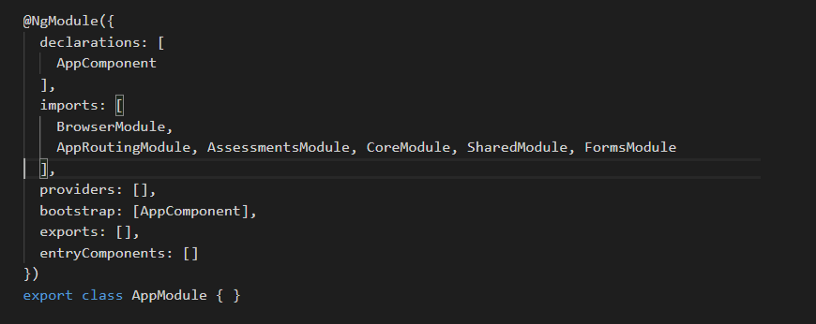
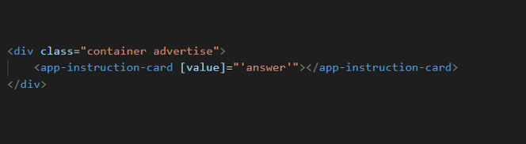
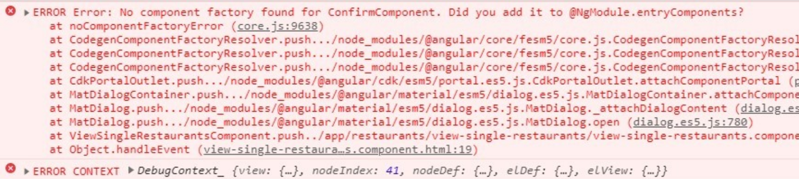


With angular 9, there has been a lot of talking going on around entryComponents, and the Angular developers who had not been much aware of entryComponents have now been interested in knowing more about it.

In this blog post, I will try to cover everything that might help you clear up all the thoughts you have around the usage, importance, and the goodbye of **entryComponents**.

# Introduction

The best way to start understanding what **entryComponents**are would be by first trying to understand component renders in Angular and how really does the compiler play a role here.

So just for a visual understanding of what we are talking right now, I have added below a snapshot of the component declarations inside the root module.



Basically, there are two types of component declarations, ones which are included as a reference insides templates, and the other ones which are loaded imperatively.

## What does this mean and what is the difference?

When we reference the component inside templates using the component selector, that’s the declarative way of writing components.

Something like this:



Now, the browser doesn’t really understand what `app-instruction-card` means, and therefore compiling it down to what browser would be able to understand is exactly the Angular compiler’s job.

The imperatively written template for, for example, `app-instruction-card` would look something like this:

```
const el = document.createElement('app-instruction-card');
const cmp = new AppInstructionCardCmp();

renderComponent(el, cmp);

if(ctx.val !== oldValue) {
  cmp.value = ctx.val;
  oldValue = cmp.value;
  ng.updateView(el, cmp);
}
```

This creates an element with your component name and registers it with the browser. It also checks for change detection by comparing the old Value with the current value and updates the view accordingly.  
We write templates declaratively since the Angular compiler does this rendering bit for us.

Now, this is where we we can introduce ourselves to what entryComponents are!

> **entryComponents** are the type of components which are imperatively loaded or now that we know what imperative loading means, we can say, entryComponents are those which are not referenced inside the template.

Before Ivy, Angular would create Ngfactories for all the components declared in the template and as per the NgModule configuration. During the runtime it would enable tree shaking for the components not used. This is why the dynamic components with no Ngfactories could not be rendered and would throw an error like:

```
No component factory found for a `my-dynamic-component`
```

Adding the component to the `entryComponents` array would then make the factories for these dynamic components available at runtime.

How Angular specifies a component as an entryComponent behind the hood can be in different ways.

* ***Bootstrapping the component*** is one of the ways of declaring entryComponents. This renders the root component inside the DOM when we launch the app in the browser.  
  The bootstrap array inside the NgModule defines this entryComponent and lets the compiler know that this component should be launched onto the browser with the bootstrapping of the application.

> Another way of bootstrapping your component can be done using the **ngDoBootstrap()** method wherein we can imperatively define which component to be bootstrapped on the launch of the app in the browser. This is more imperative way to write since you create an element for the component selector and check for change detection.

Using ngDoBootstrap() and using the same imperative code to declare a component bootstraps it and makes it an entry component into the browser.

* Specifying components in **route definitions**This is the other way Angular specifies a component as an entry component. If we look at the routing definitions, we always specify the routable component class in the definitions and this is when the CLI registers all the routable components as entryComponents.

Now, you’d be wondering that if entryComponents have such a massive role to play in component declaration, why do we as developers see it rarely used?  
As we discussed above, entryComponents are mostly specified in two ways, bootstrapping them or defining them in a router definition. But since these happen under the hood, we hardly notice it. However, when working with dynamic components, or web components in Angular, we explicity define the components as entry Components inside the **entryComponents** array.

Inside @**NgModule**, we can define the component inside this array:

> entryComponents: […]

# Role of entryComponents in smaller bundle sizes?

Alright, think for a minute. When we declare multiple components inside the declarations array of our modules, does that mean all these components will be included inside the final bundle?

This is where ***entryComponents*** have a role to play. So the answer first of all to the above question is NO. All declared components aren’t necessarily present in the final produced bundle. It is if they are specified as entryComponents what decides if they’d be present in the produced bundle.

This basically means that all the routable components will be present in the bundle for sure and also the bootstrap component obviously. This would also include the bundles that are declared inside the templates of other components. However, the tree shaking process will get rid of all the unused components with no reference without having to include them inside the package.

**EntryComponents** are mostly explicity defined when dealing with dynamic components, like I said before. This is because there needs to be a reference for the compiler to understand that **THOUGH**, there is no reference for a particular component in the template or router for now, there is a possibility for it to be rendered dynamically when required. The **ComponentFactoryResolver**takes care of creating this dynamic component for us but we specify this inside the entryComponents array inside NgModule.

If you have worked with dynamic components before, you might have faced an error like:



# Coming to the point why entryComponents are no longer required.

Now knowing why need entryComponents, lets discuss a scenario where in we have created a dynamic component and have added it to the entryComponents array.  
This basically means that now since we explicitly declared it as an entryComponent, the tree shaker would not prune this component thinking that it doesn’t have a reference in the template. Also, specifying it as an entryComponent would create a component factory for this dynamic component.

First, the **entryComponent** for a particular dynamic component could be added automatically whenever a dynamic component was created to be used. So this would save the developer from specifying it everytime to make sure the compiler knows the component. One more issue with using entry component was referencing the entryComponents declared inside a lazily loaded module. So if a lazy loaded module contains a modal component as an entry component, you’d face an error like `No component factory found for this component.` This was because the root injector couldn’t be referenced to create a component factory for the entryComponent. One solution, though not very promising was creating a component resolver factory yourself for a particular entry component inside the lazy loaded module to be able to execute it.

# However,

**With Angular 9 coming in and Ivy as the new rendering engine**, all the components would be considered as `entering components` and do not necessarily need to specified inside the entryComponents array.

# Why?

With Ivy, the components will have locality and this means that dynamically importing these dynamic components will always work regardless of presence of entryComponents or ANALYSE\_FOR\_ENTRY\_COMPONENTS.

This is because NOW, the presence of the @Component decorator would mean that the factories would be generated for this component and this happens due to the **ngtsc compiler which is like a set of TypeScript transformers**and these transformers introduce the static properties **θcmp** and**θfac**. These static properties are then able to easily access the code required for instantiating a component/module etc.

See the update from the Angular official documentation here:

https://next.angular.io/guide/deprecations#entrycomponents-and-analyze\_for\_entry\_components-no-longer-required

A demo here shows how entryComponents are longer required with Angular 9

https://ng-run.com/edit/c8U6CpMLbfGBDr86PUI0

# Some more references to be curious about:

* [https://angular.io/guide/entry-components](https://next.angular.io/guide/entry-components)
* <https://github.com/angular/angular/issues/28977>
* <https://github.com/angular/angular/issues/28826>

