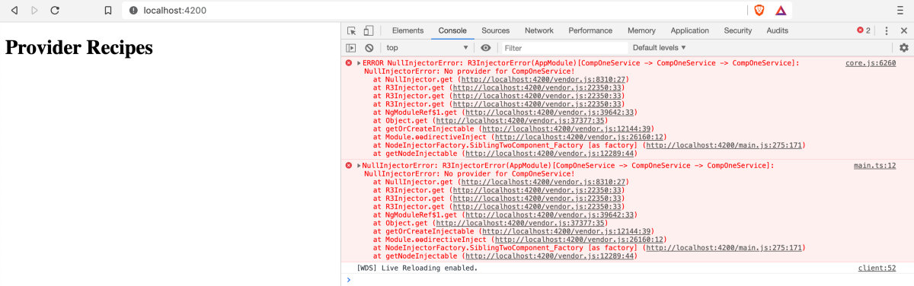


The title seems vague? I hope you guessed already what it is going to be about. In this blog post, I will be sharing about dependency injection in general and move to further discuss the `DI details` in Angular framework. I will try to dive deeper into the topic and demystify some of the less known concepts in the vast DI system that we follow in Angular.


Photo by [Inja Pavlić](https://unsplash.com/@inja_jeki?utm_source=unsplash&utm_medium=referral&utm_content=creditCopyText) on [Unsplash](https://unsplash.com/s/photos/details?utm_source=unsplash&utm_medium=referral&utm_content=creditCopyText)

### Dependency Injection, in general

Let us take an example to understand dependency injection in general.

```
public engine: Engine;
public tires: Tires;

constructor() {
this.engine = new Engine();
this.tires = new Tires();
}
```

In this case, whatever a class needs, it creates an instance of it by directly referring to that class and then gets the property/method from that class. This way, every class creates a copy of whichever dependency it needs and the code become unmanageable and difficult to test. This is because every class would have their copy of the dependency.

Also, if any of the classes evolve and may need some parameter in their constructor, our class will break since there is a change in Engine class for example, but we haven’t changed our code accordingly. This can create problems if it happens often and there is deep level nesting of these services that you are relying on.

Another point to be considered is the presence of hidden dependencies that show up when we go head to test our applications, and you’d definitely not want to come across such scenarios when you are at the stage of testing your application.

Now this is the version without using dependency injection which leads to brittleness in the code.

### Let us look at the version with DI now.

Now to reduce the tight coupling of the code that we saw in the example above, instead of creating a copy of the class in the class, we actually inject an instance of the service in the constructor of the class.

This will lead to loosely coupled code but with more flexibility to deal with the data in the service and will make it easier to test since we have full control over its dependencies now.

This really helps us perform the task without having to create multiple copies of an interface and in the case of Angular DI specifically, typescript looks at the service class just like an interface.

Example:

```
constructor(private dataService: DataService)
```

Now, this DataService can basically access the different dependencies class might need and the hidden/nested dependencies will be taken care of by this injection.

### Angular’s DI

> Providers

A provider is the first thing that we should understand when trying to understand the DI mechanism.   
As per the Angular docs,

A provider is what tells the injector how to create a service. This is like having a token and a recipe.

The way we specify tokens is by adding the service type to the providers array inside the NgModule or the Component’s providers array. The other way is to specify providedIn: ‘root’ in the Injectable decorator inside the service that we created.

```
@NgModule({
  declarations: [
    AppComponent
  ],
  imports: [
    BrowserModule
  ],
  providers: [DataService],
  bootstrap: [AppComponent]
})
```

Now, here the DataService that we have provided is actually is a provider token which looks for a recipe for it.

Now this is basically a shorthand syntax for this object literal way of writing it.

```
provide: DataService, useClass: DataService
```

Now useClass is one of the recipes for the service, let us look at more of these recipes which help us provide services to the app.

Let us avoid using the `providedIn: ‘root’` syntax for now only to be able to understand the different recipes we have to provide services.

We will create another service which implements this DataService now using the CLI, get rid of providedIn: root, and:

```
class DataService implements ExtendDataService {
  sendData(){
      console.log('extend data service called!')
  }
}
```

```
provide: DataService, useClass: ExtendDataService
```

This would basically mean that whenever there is the reference to DataService, the ExtendDataService will be called. So even if in my component, I use:

```
constructor(private dataService: DataService){}
```

It would return the ExtendDataService.

### Using the **useExisiting** recipe

To specify an already defined instance of the service, we use the useExisting recipe as follows. This is like having two ways to access the same service.

```
providers: [  
ExtendDataService,  
{provide: DataService, useExisting: ExtendDataService}  
]
```

This will mean both the instance references in the component will lead to the use of same ExtendDataService.https://nishugoel.wordpress.com/media/4cc0b7b395ae1ae3897c7907e3353f19

### useValue

This particular recipe doesnt use the new keyword to generate an instance of the service and instead, it used the value specified in the provider and uses that for the token specified.

For example:

```
provide: DataService, useValue: {  
sendData: (data)=> console.log(data),  
error: (error)=> console.log(error)  
}
```

When referred to, in the component, this would take the value as:

```
constructor(private dataService: DataService){}
```

and operate whatever useValue recipe asks it to do here.

### useFactory

This is a service factory function. Let us see how this one works.

Let us create a service called LoggerService, and. a factory function for the same.

```
import {DataService} from './data.service'
import {LoggerService} from './logger.service';

export function logServiceFactory(dataService: DataService){
  let loggerService: LoggerService = new LoggerService(dataService);

  dataService.sendData("From the log service factory");
  return loggerService;
}
```

Now let us provide this inside the module:

```
providers: [  
{  
provide: LoggerService, useFactory: logServiceFactory, deps: [DataService]  
 }  
]
```

Now our factory service will be referenced every time we get an instance of LoggerService referenced from the component.

Here is a demo of using these four provider recipes.

**DEMO**

```
https://stackblitz.com/edit/provider-recipes
```

> Injectors

We learnt about the providers and the different provider recipes that we can use, what about injectors? Let us look at those now:

* We know the main role of an injector is to provider services when ever there is an injection in the constructors of components/services. They maintain a single instance of the service provided.
* Also, on the basis of the emitted metadata, injectors have to determine what should be injected. And if no token is found, they make sure to go up one level and see if this can be delegated to the parent injectors and so on.

The metadata plays a major role in helping the injector know about the type, method declared in the class.

This is enabled with the help of the enableDecoratorMetadata compiler option in the file `tsconfig.json` . With this option being set to false, the DI system wont be able to find what to inject and what are the method/properties defined in the injector. This is also what specifying a decorator above the class helps with.

> This option is true by default when the application is created using Angular CLI.

The injectors in Angular applications which work hierarchically. The root level injectors are specified by either specifying them in the providers array of the NgModule or setting it as providedIn: ‘root’ in the service itself.

There are different scenarios that we come across while specifying this. For example, specifying a provider inside a lazy loaded module will create a child level instance of the service.

Referring to it in the child component, the injector will look for the provider like follows:

* It will look for the provider at this child component level, if cant find,
* It will go to the parent component, if its been specified at the component level, if not
* It finally goes to the root injector which will have an instance of the service and thus provide it.

> An important thing to note is, if we specify a service at the component level, and sibling component is trying to refer to it, it will throw an error since the injector will only look for the provider in the parent injector/root injector.

This is where it becomes important to keep a careful check on how many instance of it are we creating in the hierarchy.

Get to see an error like this?

```
No provider for DataService
```

Now you know where to check, either you forgot to provide it entirely or maybe at the wrong place, because remember, that the injector checks for the provider up the hierarchy and not at the same level.



Some of the good and safe practice therefore would be to ensure:

* Declare service at the root level if you think the service will be needed globally in the app.
* If you are sure it is very specific to the component, just declare it in the providers array of the component.
* For all the core features of the app? Create a core module and provide the service inside that.

Here is a demo of how we might end up in a problem if declared a service at a component level and tried to referred to it from a sibling component.

```
https://stackblitz.com/edit/provider-check
```

### Circular References?

When in a scenario when class A is referring to class B and vice versa, we end up in circular reference and this is usually a problem when having multiple classes in a file and not a one class one file structure. But Angular has a way to get rid of this using `forwardRef.` This creates an indirect reference which Angular can resolve later.

This circular reference can be dealt with by using:

```
providers: [{ provide: ParentService, useExisting: forwardRef(() => MyFirstComponent) }],
```

As mentioned before, this is mainly a use case when dealing with multiple classes per file.

> If you could make it until here and liked the article, do press the clap button 🙂 Thank you!
>
> Feedback welcome. ❤ ❤ ❤

