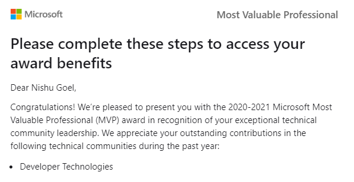


Around May 2018, I started my journey of development and with Angular. With loads of learning and projects in the progress, I started writing blog posts and sharing my understanding with others through the writings, videos, discussions etc.

This gave way to diving deeper into technology and I started sharing my learning by delivering talks at events/meetups/conferences. The best part was the decision to write a book which of course was not an easy thing.

---

This May, I got awarded the Microsoft Most Valuable Professional award and I am really grateful to the amazing community of super supportive and motivating people who inspire us everyday to do amazing stuff around tech.

I have received great love from so many developers and I sometimes fear if I am doing enough and if I am capable of this much love from everyone. I really hope to keep contributing and working harder.

I am always grateful to DJ, a very kind soul and and an amazing mentor, Deepak Rajendran for being super sweet, motivating, and so supportive, and believing in me. And of course each and every member in the community.

> [Learn more about the Microsoft MVP program here.](https://mvp.microsoft.com/)
>
> Read my blog posts here: <http://nishugoel.wordpress.com/>

*Trying to be as kind as one can be,  
Nishu*

