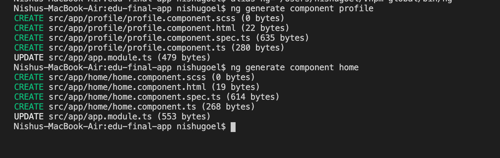


1. Create relevant components and modules
2. Perform routing in your app
3. Prepare services to interact with data
4. Manage the state of the application

We’ll create a cart example where we would implement all the concepts like services, routing, state management using services etc. It would basically look like:

```
https://nishugoel.files.wordpress.com/2020/06/cart-app-2.gif?w=1024
```


<video controls="" src="https://nishugoel.wordpress.com/837299e1-3a46-47bb-9465-3b09229f50fb"></video>


## Set up development environment

1. Install node and npm
2. Check if installed using npm -v and node -v
3. Install Angular CLI

```
npm i -g @angular/cli@latest
```

If using MacOS/Linux, set the path specifically.

e.g.,

```
alias ng="PATH_TO_GLOBAL/.npm-global/bin/ng"
```

4. Check Angular CLI version using `ng version or ng v`
5. If installed properly, create a new app using the command:

```
ng new edu-final-app
```

6. You are ready to start building your app!
7. Check the running app on localhost:4200 which brings up a default view.

## Create required components and modules

Let us first create the basic components

```
ng generate component homeng generate component profile
```



We want a separate feature in our application for the products-listing, cart etc. So, let us create a **ProductModule** and **CartModule** wherein we will create all the components related to product feature.

```
ng generate module product
```

```
ng generate module cart
```

Create some components inside the cart module and product module like the cart component, product-list component, product-card component.

This looks like: 

Now with almost all the components ready, we can go further and decide which ones will be the routable components or nested components.

The CLI generated an app-routing.module.ts file for us when we created the application. This is to better organise our components/modules. Now since we simply want to keep the routes in a separate file, we don’t actually need a module for that, so let’s refactor this a bit and remove the module from the code.

**app-routing.module.ts** currently

```
import { NgModule } from '@angular/core';
import { Routes, RouterModule } from '@angular/router';
 
 
const routes: Routes = [];
 
@NgModule({
  imports: [RouterModule.forRoot(routes)],
  exports: [RouterModule]
})
export class AppRoutingModule { }
```

Let us refactor and export only the routes from here:

```
import { Routes } from '@angular/router';
 
export const routes: Routes = [
  // router states here
];
```

**app.module.ts**

```
import { routes } from './app-routing.module';
 
@NgModule({
  declarations: [
    AppComponent,
    ProfileComponent,
    HomeComponent
  ],
  imports: [
    BrowserModule,
    RouterModule.forRoot(routes) //router here
  ],
  providers: [],
  bootstrap: [AppComponent]
})
export class AppModule { }
```

Having done this refactoring, let us define the router states now.

## Perform routing in your app

There are mainly five different views which can be routed to.

1. Home Component/Dashboard Component
2. Profile Component
3. Product Listing Component
4. Product detail component
5. Cart component

And and we saw in the routing section, we can specify a redirect path and a page not found component too.

So, let us create these router states now in the refactored app-routing.module.ts.

```
import { Routes } from '@angular/router';
import { HomeComponent } from './home/home.component';
import { ProductListComponent } from './product/product-list/product-list.component';
import { ProductCardComponent } from './product/product-card/product-card.component';
import { CartComponent } from './cart/components/cart.component';
import { ErrorPageComponent } from './error-page/error-page.component';
 
 
export const routes: Routes = [
  {path: 'home', component: HomeComponent},
  {path: 'products', component: 
   ProductListComponent},
  {path: 'checkout', component: 
   CartComponent},
  {path: '', redirectTo: '/home', 
    pathMatch: 'full'},
  {path: '**', component: 
   ErrorPageComponent}
];
```

## Where do we place these?

Placeholder? Router-outlet.

So let us specify a placeholder in the app component which can have a header, footer and body only contains:

```
<router-outlet></router-outlet>
```

## Route parameters

```
{path: 'product/:id', component:    ProductCardComponent},
```

To view the route for a specific id of the product, we can use the route param and extract the data related to that id using the **`ActivatedRoute`** service.

We will nest the other components where ever required and see where we can use multiple components effectively.

## Prepare services to interact with data

We have the relevant components and routing in place now. On the first view, the home view, we have a simple welcome component called HomeComponent. We get to explore and look for products from this view.


Something looking like this. Now to add router link to go to the products view, we will add routerLink directive on the click of this button.

```
<button class="btn btn-info" routerLink="/products">Search products</button>
```

The idea is now to fetch the products on the rendering of the products view. We can perform this using either a JSON data, an in-memory data store, or a dummy API.

For this application, we will be using the API from [jsonplaceholder.com](http://jsonplaceholder.com/) to get the list of products.

As we have studied about lifecycle hooks, we know that on the instantiation of the view, `ngOnInit` is invoked.

So we should be performing the request for the data in this method.

```
ngOnInit(): void { 
   this._getProductList(); 
}
```

The \_getProductList method will perform the Http request. Since we have created a dedicated service for performing the calls, let us inject that service inside the component.

```
constructor(private _productService: ProductService) { }
```

This product service is where we perform all HTTP operations, so let us understand that first in the `product.service.ts`.

```
constructor(private http: HttpClient) { }getProducts(){ return this.http.get('https://jsonplaceholder.typicode.com/photos')  }
```

There is a lot happening here, let us understand these one by one.

We have injected the HttpClient service inside the product service to be able to perform HTTP operations. This comes as a part of **HttpClientModule**.

We can get to perform the different operations(request, get, delete, etc.) as a part of this service now.

First, let us get the list from the API:

https://jsonplaceholder.typicode.com/photos

```
  getProducts(){    return this.http.get(APP_CONSTANTS.GET_PRODUCTS)  }
```

or we can place it inside a constant. Now to get this data inside the component from this service, we can simply subscribe to the data that is returned as an Observable.

```
private _getProductList() {    this._productService.getProducts()    .subscribe(data => {      console.log(data);      this.products = data    })  }
```

We can finally display this on the template using the products variable.


Here’s when the tricky parts comes, we want to be able to see the details of each product individually.

We will therefore, pass the route params as the product id and load that particular details. In the routing config,

```
{path: 'shop-product/:id', component: ShopProductComponent},
```

```
buy(id){    this._router.navigate(['/shop-product', id])  }
```


Look closely at the url here.

```
http://localhost:4200/#/shop-product/1
```

Explore more products will take us back to the `/products` view.

The next step we want to achieve is to increase the cart count on the click of add to cart button. This state has to be managed across the whole application. So we will send the action using subjects and observables and subscribe in the cart holder component.

```
counter: number = 0; 
 private _tokenProviderSubject: BehaviorSubject<number>;
  public tokenProviderObservable$: Observable<number>; 
 constructor(private http: HttpClient) {   
  this._tokenProviderSubject = new BehaviorSubject(0); 
   this.tokenProviderObservable$ = this._tokenProviderSubject.asObservable(); 
 }
```

In the service, we create a behavior subject to be able to send an initial value and an observable which we will associate with teh subject using:

```
this._tokenProviderSubject = new BehaviorSubject(0);    this.tokenProviderObservable$ = this._tokenProviderSubject.asObservable();
```

and send 0 as the initial value since we are creating a counter observable here.

In teh app.component now, wehere we have the cart, we can add the subscription for that observable, but before that we should be incrementing the counter value every time, the user clicks on the add to cart button. To do that,

```
add(){    this._productService.setCounter();  }
```

In the product service,

```
setCounter(){    this._tokenProviderSubject.next(++this.counter);   }
```

The final step is getting this counter updated value in the app.component.

```
ngOnInit(){    this._prodService.tokenProviderObservable$    .subscribe(data => this.counter = data);  }
```

On the template, we simply interpolate the counter value.

```
<div> <span>   {{counter}} </span></div><router-outlet></router-outlet>
```

We saw how to communicate among components having have nested or routing-based relationship. We performed the concept of Subject/observables to send the data throughout the application.

The problem that we faced however, was that since it is large data, it takes some time to load, and we don’t want our user to be getting such an experience, so we will implement a loader service which shows the waiting loader in the time when the data is not retrieved yet.

Let us see how to do that, we will use the same idea that we followed before. We want to create a subject and observable which maintains the value of a boolean variable which decides whether the loader should show or not.

A visual idea of what we are trying to do is: 

First, let us create a loader component with the template and style of a loader.

```
<div class="faded-loading-screen">      <div class="spinner"></div></div>
```

We want this to appear on the app level view if some data is being retrieved.

```
<section *ngIf="fadedFullScreenLoaderFlag">    <app-spinner></app-spinner></section> <div (click)="checkout()"> <span>{{counter}}</span></div><router-outlet></router-outlet>
```

So, the flag `fadedFullScreenLoaderFlag` is to be noticed here.

This has to be set based on a **boolean value** that we get by subscribing to the observable who responsibility is to inform the app component about the data being received.

Let us take the example of our product-list component. What we are trying to achieve is on that initialisation of the component we want to show the loader and once the data is retrieved, in the success handler of the api call, we can set the show loader to be false.

```
ngOnInit(): void {  
  this._fadedLoadedService.setLoadingScreenState(true);  
  this.id = +this._activateService.snapshot.paramMap.get('id'); 
   this._getProduct(); 
 } 
// Set it false on api success

private _getProduct() {   
 this._productService.getProduct(this.id).subscribe(data => {     
 this.productData = data; 
 console.log(data);  
 this._fadedLoadedService.setLoadingScreenState(false);      })  }
```

We are setting a state to be true or false whenever the component loads/gets the data. But, what is this state? What is the faded loaded service.

So to perform the emitting of data, let us create a faded loaded service.

```
import { Injectable } from '@angular/core';
import { Subject, Observable } from 'rxjs'; 

@Injectable({  providedIn: 'root'})
export class FadedFullScreenLoaderService {  
   private _fadedScreenLoaderSubject = new Subject<boolean>();  
 public fadedScreenLoaderObservable$: Observable<boolean>; 
 constructor() { 
   this.fadedScreenLoaderObservable$ = this._fadedScreenLoad 
   erSubject.asObservable();  
}  
 public setLoadingScreenState(state: boolean) {
    this._fadedScreenLoaderSubject.next(state); 
 }}
```

Just like we did in the case of counter, here we set a boolean value for the observable and send it to whichever component subscribes to this observable.

This observable can now be subscribed to, in the **app.component.ts**

```
private _subscribeTofadedObservable = (state: boolean) => {   this.fadedFullScreenLoaderFlag = state;}
```

You might end up getting an error like

```
'Expression changed after it has been checked'
```

To resolve this, we can simply set some timeout to avoid the value change detection issue happening here.

```
private _subscribeTofadedOnservable = (state: boolean) => {    this._timeouts = setTimeout(() => {    this.fadedFullScreenLoaderFlag = state;    }, 10);}
```

Finally the flag gets the state of loader and display it accordingly.

Now, product.service.ts

```
@Injectable({
  providedIn: 'root',
})
export class ProductService {
  counter: number = 0;
  products: Array<{}> = [];
  private _tokenProviderSubject: BehaviorSubject<any>;
  public tokenProviderObservable$: Observable<any>;
  constructor(private http: HttpClient) {
    this._tokenProviderSubject = new BehaviorSubject(0);
    this.tokenProviderObservable$ = this._tokenProviderSubject.asObservable();
  }

  getProducts() {
    return this.http.get('https://jsonplaceholder.typicode.com/photos');
  }

  getProduct(id): Observable<any> {
    return this.http.get('https://jsonplaceholder.typicode.com/photos/' + id);
  }

  setCounter(id) {
    id === null ? (this.counter = 0) : (this.counter = this.counter + 1);
    this.getProduct(id).subscribe((data) => {
      this.products.push(data);
    });
    this._tokenProviderSubject.next(this.counter);
  }
```

Display the data on the cart view.

```
<div *ngFor="let prod of products">     
   <div class="prod-card">           
      <div>Product {{prod?.id}}</div> 
      <div>
        
      </div> 
   </div> 
</div>
```


In the cart.component.ts,

```
complete() {
    this.ordered = true;
    this._productService.products = [];
    this._productService.setCounter(null);
}

explore() {
    this._router.navigate(['/products']);
}
```

Play around with the code below and improvise in terms of performance, styling, different better approaches etc.

<https://github.com/NishuGoel/edu-final-app>

## Thanks!!

