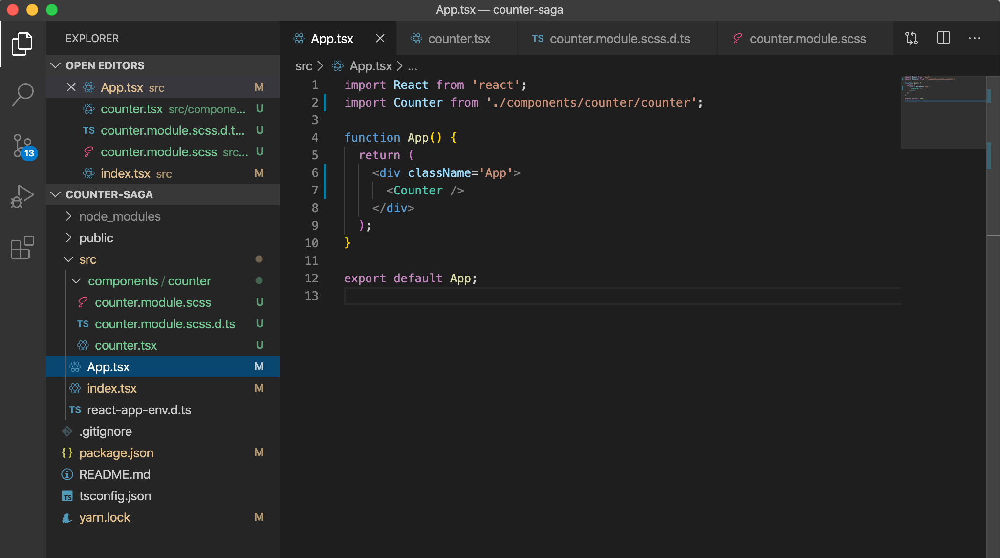
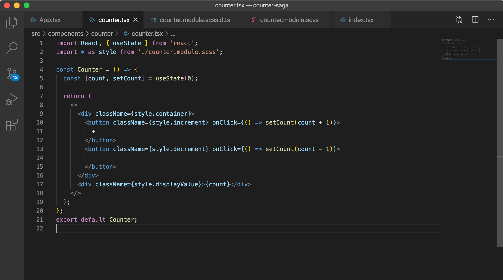
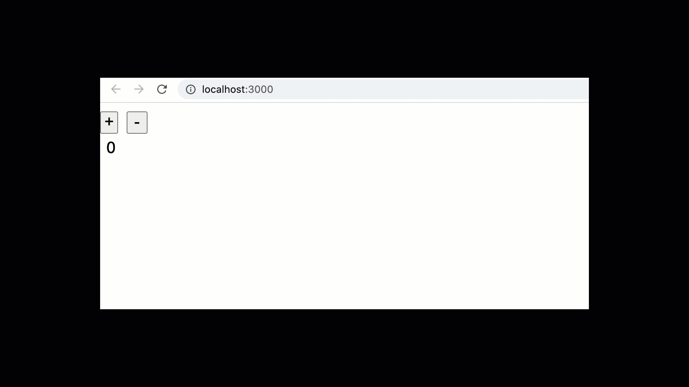
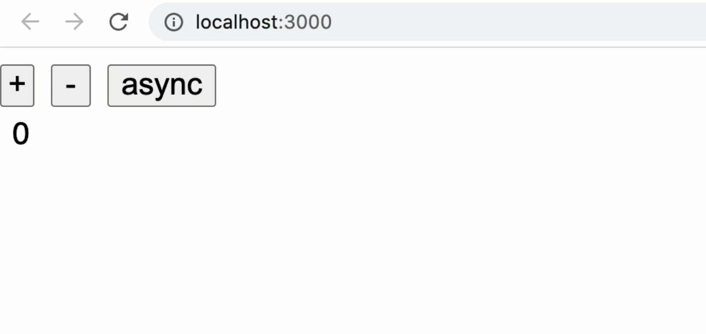


Have been exploring redux-saga lately and thought I will put down here a simple counter example using Redux saga with TypeScript to manage the counter state across the application.

We will start with with a simple create-react-app with a Counter Component. In the first part of the article, we will see how to modify the state of the counter without using redux. And in the second part, we’ll maintain the state using redux saga. I am putting it down here, hope this helps some of you too.



The application built using the template flag as typescript contains only one component counter components which we display on the app. The component styles will be named dynamically as per the name we define for the style in our `module.scss.d.ts` file.

In the Counter component,



we have two simple buttons to increment and decrement the counter value. This counter value is maintained in the count variable and we either increase or decrease the count value using the useState hook.

As per reactjs.org,

> Hook is a special function that lets you “hook into” React features. For example, `useState` is a Hook that lets you add React state to function components.

The initial value of count is set to zero as here:

```
const [count, setCount] = useState(0);
```

Now using the setCount method, we can set the state as what ever is specified without actually mutating the state.



Simple, right?

Now this is a small component with just one value to be taken care of, however as our components increase, we might want to have a store where we literally store all the important data. For example, what if the state of the counter value is taken care of globally, and not at the component level?

This is when we come to using Redux, a state management library for managing state throughout the application.

In this part, we’ll see how to use Redux saga to perform counter increment, decrement and an asynchronous operation of incrementing the counter value. This is because we go for middleware like Thunk, redux-saga when dealing with async operations.

# Using redux-saga for counter async

Now, without having a count value in the counter component, we will keep this in a global state and create sagas to deal with it.

Redux saga is a companion library for redux that helps to manage the async floe of our app. Think of redux saga like a thread that is responsible for taking care of all the side effects that might generate when performing async operations. And these can be handled using the same redux operations.

Let us look at a regular function.

```
function anonymous() {  
   return ;  
}
```

This returns only one value. What if you want to return multiple values?  
Redux saga uses generators to return multiple operations from a function. Also what if we want to pause the execution of a function in between, we can not do that unless we return something.

So a generator can be used to enhance the power of functions. Let us create a generator function.

```
function* anGenerator() {  
   return 'one';  
}const value = anGenerator();  
console.log(value) // --> {[Iterator]}
```

As you see here, this not only returns ‘hi’ but a generator object/iterator. This helps us to iterate over the multiple values returned by the geneerator.

We use the keyword`yield` to do that.

```
function* anGenerator() {  
   yield 'one'  
   return 'two';  
}const value = anGenerator();  
console.log(value.next()); // {value: one, done: false}  
console.log(value.next()); // {value: two, done: true}  
console.log(value.next()); // {value: undefined, done: true}
```

as you see, the generator gets paused after one usage of next method, and finally when the values are complete, the done gets true indicating that it is complete and value now becomes undefined.

Now that we have understood how generators work, lets get to creating a store in redux.

Step 1. Create a `store.ts`

```
import { createStore, applyMiddleware } from 'redux';  
import createSagaMiddleware from 'redux-saga';const sagaMiddleware = createSagaMiddleware();export const store = createStore(reducer, applyMiddleware(sagaMiddleware));sagaMiddleware.run(rootSagas);
```

In here, we are creating a store with the reducer we will create and the saga middleware that we have created.

We use the applyMiddleware method from redux to use this sagaMiddleware and apply it to the store. This **sagaMiddleware** then uses the run method to run all the sagas present.

Step 2. Let’s create **actions and reducers**.

```
export const INCREMENT = "INCREMENT";  
export const DECREMENT = "DECREMENT";  
export const INCREMENT_ASYNC = "INCREMENT_ASYNC";export function reducer(state = 0, action) {  
   switch (action.type) {  
      case INCREMENT:  
         return state + 1;  
      case DECREMENT:  
         return state - 1;  
      default:  
         return state;  
    }  
}
```

Here, we have three actions to perform Increment, decrement, and increment asynchronously.

In the reducer, we initialise the state as zero and perform operation for different action cases. This is simply handled the redux way for increasing and decreasing the counter value. However, for incrementing asynchronously, we create the saga file now.

```
import { put, takeEvery, all, delay } from 'redux-saga/effects';  
import { INCREMENT, DECREMENT, INCREMENT_ASYNC } from './reducer';function* incrementAsync() {  
   yield put({ type: INCREMENT });  
   yield delay(1000);  
   yield put({ type: DECREMENT });  
   yield delay(1000);  
   yield put({ type: INCREMENT });  
   yield delay(1000);  
   yield put({ type: DECREMENT });  
}function* watchIncrementAsync() {  
   yield takeEvery(INCREMENT_ASYNC, incrementAsync);  
}export function* rootSagas() {  
   yield all([watchIncrementAsync()]);  
}
```

Now this is very important. There are basically two steps. One operation that does the job of firing the request and the other operation to implement it. This is the worker saga and watcher saga concept. The takeEvery helper function from redux-saga/effects takes every INCREMENT\_ASYNC action or literally watches for the action and then the worker saga does the operation. Like in this case, whenever the saga gets the action, the generator function incrementAsync gets executed and yield multiple operations. Increment, decrement, then increment and then decrement. The actions INCREMENT and DECREMENT are then handled by the reducer. It seems we have wired up redux saga and the store.

Now the final step is to connect this store to our react app.

Step 1. In the **index.tsx**, we first provide the whole app the store

```
<Provider store={store()}>  
   <React.StrictMode>  
     <App />  
   </React.StrictMode>  
</Provider>,
```

Step 2. Connect the Counter to redux using the connect function from `react-redux`.

```
const action = type => () => ({ type });  
export const Counter = connect(state => ({ value: state }), {  
    onIncrement: action(INCREMENT),  
    onDecrement: action(DECREMENT),  
    onIncrementAsync: action(INCREMENT_ASYNC),  
})(Counter);
```

When this is done, we have connected our react app to redux and for the async operation, our saga will perform the action whenever **INCREMENT\_ASYNC** action is dispatched.

Let us create one button more to dispatch the async operation and look at how the app responds.



The source code: <https://github.com/NishuGoel/counter-redux-saga>

