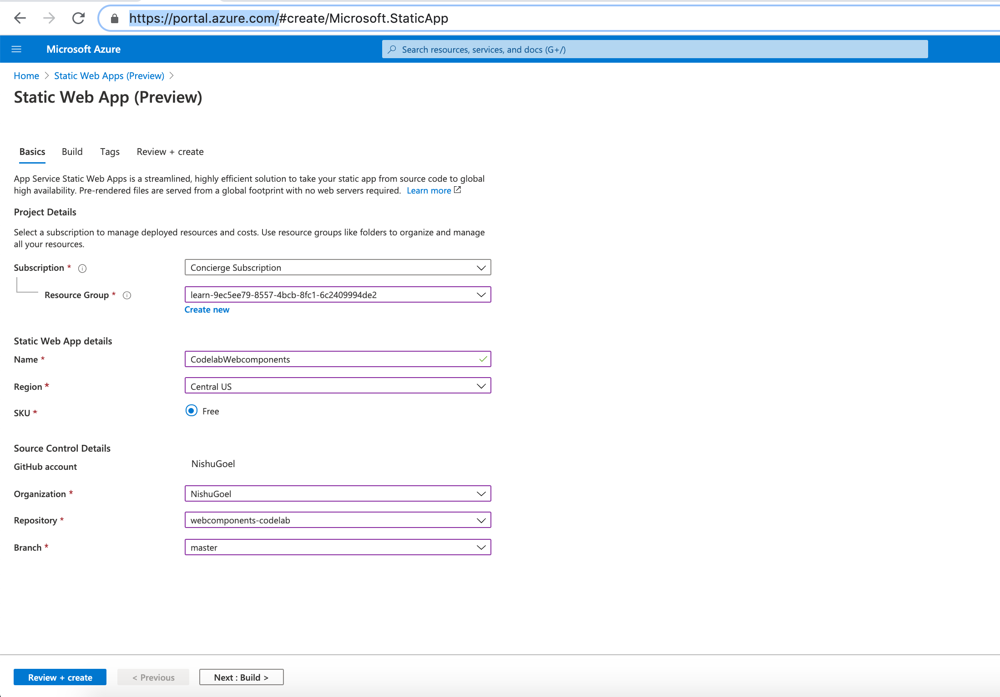
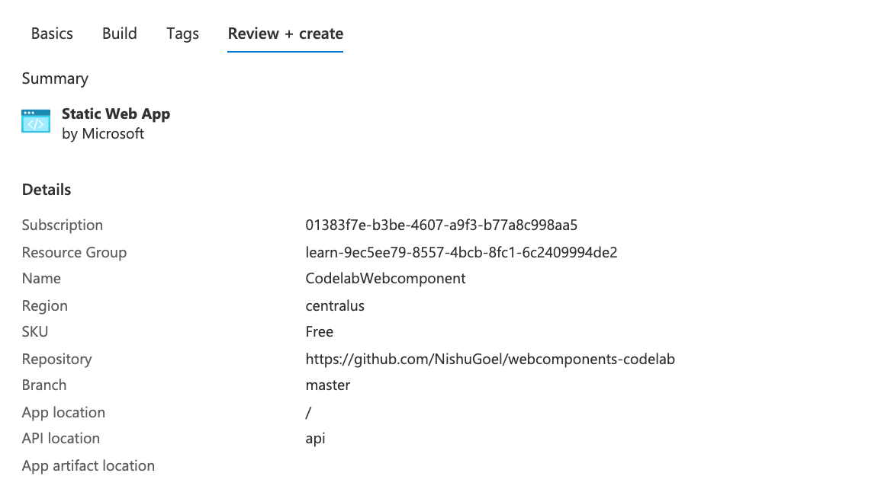
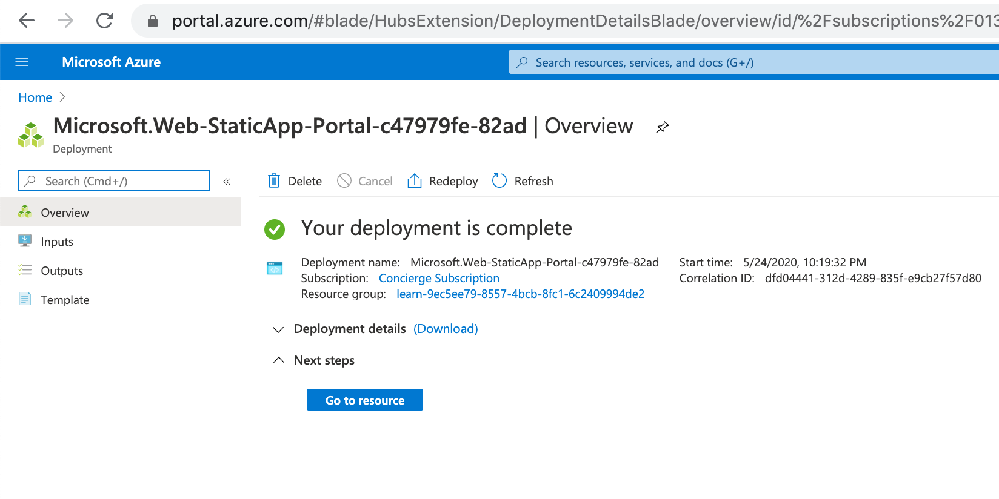
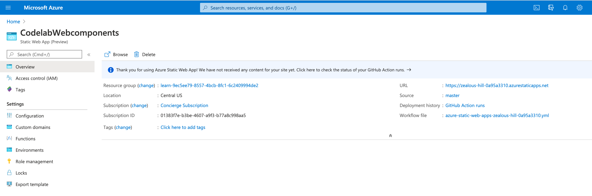
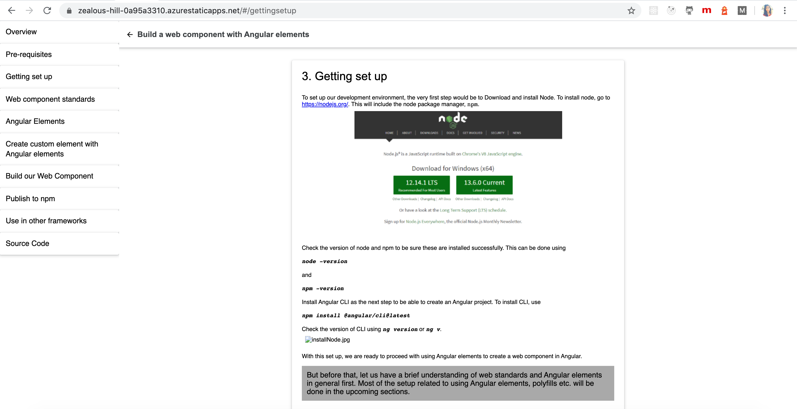


Building your app from a Github repository, with monitored commits and continuous deployment. Sounds fun? We can do this using Azure Static web apps. This was announced at Microsoft Build this year 2020. And, it seems to be making the task of building and hosting our web applications seamless.

*heard it right! Hosting web apps, continuous deployment from the Github repo, free SSL certificate that gets auto-renewed, wondering about API support? Azure functions help with that.*

# What does it take?

* GitHub repo ([*Github action*](https://github.com/NishuGoel/azure-static-web-app.git)*s*)
* Azure portal (*Static web app*)
* Building and committing

# First steps first

Have an existing application on Github and you want to deploy and host it. Let us see how:

```
To create a new application: 
1) Install Angular CLI - npm install -g @angular/cli
2) Create a new app - ng new <app-name>
3) Initialise a git repo - git init
4) Add all the files - git add . 
5) git commit -m "your-commit-message"
6) git push origin <branch-name>
Note: Since the Github repo only contains the source code and not the static assets, we need to build the app before we push and ensure the dist or build folder is present in the code to be pushed.
```

I have a Github repository of a code lab app I created here: <https://github.com/NishuGoel/webcomponents-codelab.git>

I will go to the Azure portal, create a new resource, look for the `Static web app (preview)` option.

This will ask for details of your organisation, resource group, Github organisation, repository, branch etc.



I have attached my webcomponents-codelab repo here and creating this app will now add a Github action workflow to my app which will ensure Github builds and deploys your app of that particular branch you have specified, every time you make a commit.

Let us click on Review+ Create button. Review the information that appears and finally create if everything looks fine.



As you can see in the image above, the app location is root since my app is available at the root and the API location shows to be api. Now my application doesn’t have an api source so Azure static app will ignore that, if you do have an api setup in your app, it will be configured by using Azure functions. We will look at that later.

When you click Create, your deployment process starts



Now when you go to resource, you will find all the necessary information for your app. Now the first build process was triggered when you created the app by Github actions and you can check the status of it now like so:

> Make sure you add the correct dist/<app-name> path in your github workflow file or else the root files wouldn’t be accessed and the build will fail.

When this is done, you should be able to view your running application on the given URL.



My deployed app is here: <https://zealous-hill-0a95a3310.azurestaticapps.net/#/gettingsetup>



Want to add a custom domain name? Thats also pretty straight forward. Go to the Custom domains section on the Azure home portal specify your CNAME with the DNS provider and add your custom domain.

# Configure API as Azure functions?

This is the best part of using Azure Static web apps as you can work around APIs with simple and easy azure functions.

Check out setting your APIs logic, routes, and the azure function for those here:

https://docs.microsoft.com/en-us/learn/modules/publish-app-service-static-web-app-api/8-exercise-func-app?pivots=angular

Do these changes get reflected with every commit? well, remember the API path that was getting ignored by Github actions because we had no api folder at all. That will be now triggered and update and deploy the app again every time a change in the code repo takes place.

There are times when we wish to check the api changes before deploying the code, as this might end up breaking the app. To do this, we can create the api folder in a separate branch and create a PR to the master branch when our API is working and tested end-to-end. This pull request when merged with master will run the deployment again.

Simple and easy how we can develop, build, host, continuously deploy our web apps using Azure static web apps.

Thanks! ❤ ❤ ❤

