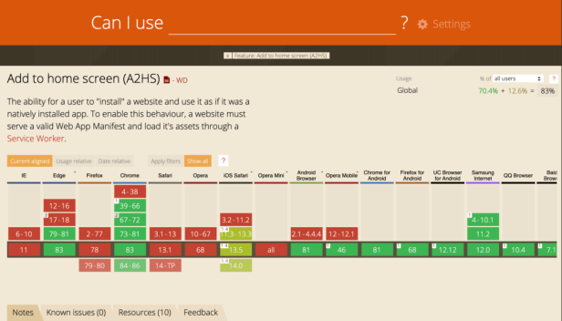
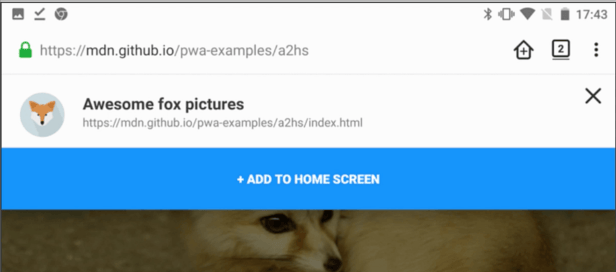
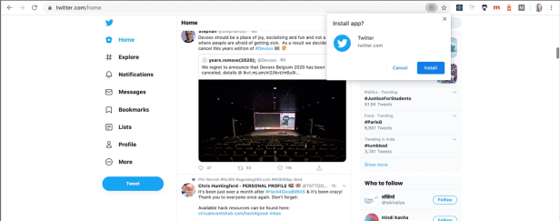
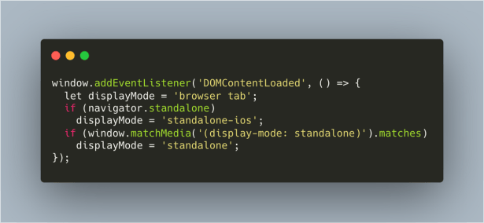


I came across a question somewhere regarding adding a custom prompt of “Add to Home Screen” for your progressive web application for the browsers that do not have a built-in support for the same. An example of this is the Safari browser that currently does not prompt the user for adding an app to your home screen as an application.

Now this intrigued me since I am an IOS user and still having never thought to implement one already. Well, it was time to react now that I woke up.

So I implemented a custom add to home screen functionality for my application. In this blog post, I will be writing about the steps I followed to do so.

To get an understanding of which browsers support the A2HS functionality built-in, this is where you can look it up: [*https://caniuse.com/#feat=web-app-manifest*](https://caniuse.com/#feat=web-app-manifest)



Let us start by understanding what are PWAs and PWA specifications in general.

TLDR; If you already understand what PWAs and PWA specifications are, please navigate directly to the [**custom implementation of A2HS**](https://medium.com/p/114d77d97fb0#5c0f).

### Progressive Web Apps

PWAs are web applications that can be reached anywhere, on any device. The web applications that we develop have great reach and if this is compared to the experience we get in native applications, one would say that the apps that we use are much more friendlier, easily accessible, and feel like a part of the device. The app will give a rendered response whether the internet connectivity is available or not!

And to get the same experience with the web apps that we develop without having to develop native application with a learning curve of their own, PWAs come into picture. This would mean you would have a reliable, capable, and an installable web application.

The features that progressive web apps offer are:- offline rendering, A2HS, service workers.

Our focus for this article is on A2HS where we will have a close look at how Add to Home screen functionality is implemented and how we can add a custom prompt for the browsers that do not have a built-in support for A2HS prompt yet.

### How A2HS works?

The Add to home screen functionality allows the user to install your PWA as an app on to their mobile or desktop device. This makes your web app as accessible as any another native applications in the launcher.

Now let us take a look at a few examples to understand how A2HS works!



Example 1

In this Example 1 above, it is a mobile view and when you open the web app in the browser, you get a prompt “Add to Home Screen” and this adds the website as an application among all the other native apps in your device.



Example 2

Similarly, in a desktop device, we see a plus icon in the browser URL bar that when clicked, gives the option to install the application.   
This is the built-in Installable feature that is called Add to Home screen, now this is not supported in all the browsers as we saw on the *canIuse* website.

So, now the idea is to implement an in-app install button that plays the same role as that of an in-build A2HS. This being an in-app feature wouldn’t be restricted due to browser support but will be fully restricted to the app’s way of working.

### Implement custom A2HS for our PWA

This is where we implement an in-app custom flow for installation our web app as a PWA in the device. And for a wide view of it, it basically involves three steps:

* Listen `beforeinstallprompt` prompt
* Save this event prompt for later
* Let the user know that this app is installable as a PWA and they can then click on the custom install button to start the installation flow.

This ***beforeinstallprompt*** comes from its own incubator code here:[**WICG/beforeinstallprompt**  
*You can’t perform that action at this time. You signed in with another tab or window. You signed out in another tab or…*github.com](https://github.com/WICG/beforeinstallprompt)

To do this in our PWA application:

***Step 1.*** Ensure that our PWA meets the Installation criteria defined for PWAs before it fires the ***beforeinstallprompt event.*** This installation criteria involves, having a web manifest file with important information, serving over HTTPS, not already installed, service worker etc.

Read the exact installation criteria of a PWA in detail here:[**What does it take to be installable?**  
*Updated Progressive Web Apps (PWAs) are modern, high quality applications built using web technology. PWAs offer…*web.dev](https://web.dev/install-criteria/)

***Step 2.*** Having made sure that PWA is installable, next step is to listen to the ***beforeinstallprompt*** event.

We are listening to the ***beforeinstallprompt*** event and now we want to show the user the prompt after we listen to this event to install the app, so inside this event listener, we will:

a) first save the event to be able to trigger it later,  
b) invoke the method that shows the installation prompt.

In code, something like below:

```
  // Step 2: Trigger the UI for Install prompt  
     this.showPromptToInstall = true;  
});
```

The most interesting thing here with this custom A2HS in our web app that I find is the flexible usage of the prompt, we can show this prompt as a snack bar, tooltip, or a small button or a tab somewhere in the app, totally as per users’s choice. Doesn’t necessarily need to be a button as Add to home screen like we saw above.

***Step 3.*** Next step is to listen to the click event of the install prompt and install the app. This is where the saved ***beforeinstallprompt*** event needs to be triggered, so we go back, pick it up and use it inside the event handler of this click of the prompt.

```
triggerEvent.prompt();   
  //user response  
    triggerEvent.userChoice.then((response) => {  
     if (response.outcome === 'accepted') {  
       console.log('yes, please install');  
     } else {  
       console.log('No thanks, I am good!');  
     }  
  });
```

Up until this level, we have completed the phase of create a custom prompt for the user to install the web app as a PWA in their device. We have also captured the ***beforeinstallprompt*** event and triggering it on user click of prompt.

Now, we can set the saved event trigger to null to ensure the *beforeinstallprompt* is probably fired once.

And we also would want to execute tiny different behaviour for different devices. For example: not showing an install option when in standalone mode or showing a back button always etc. etc.

When we wish to track how the PWA was launched, we can use the `matchmedia()` query for non-ios devices and `navigator.standalone` for the IOS ones.This helps set the display mode or any other properties accordingly.

And this example from here explains quite well on how to track how the PWA was launched.



So this sums up about how to add a custom in-app installation of our web application, and how to trigger the event when chooses to install the app, how you can also track how the PWA was launched, was it from the browser or as a standalone application.

***Demo:***

Here’s a code lab that will help you build one for yourself by coding alongside:

[**Make it installable**  
*This glitch already contains the critical components required to make a Progressive Web App installable, including a…*web.dev](https://web.dev/codelab-make-installable/)

This helps us have different styles and behaviour as per the way the app was launched.

Let me know if this helped you! Thank you very much. ❤ ❤ ❤

