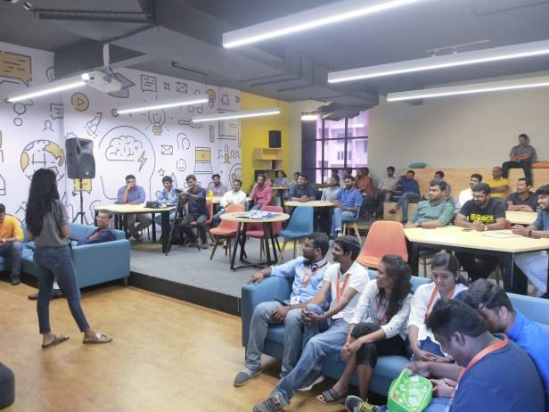
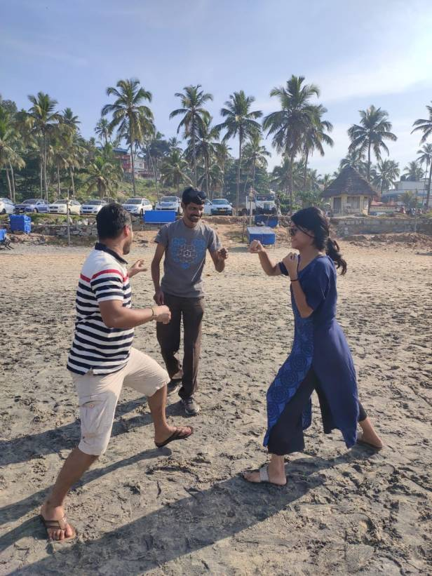
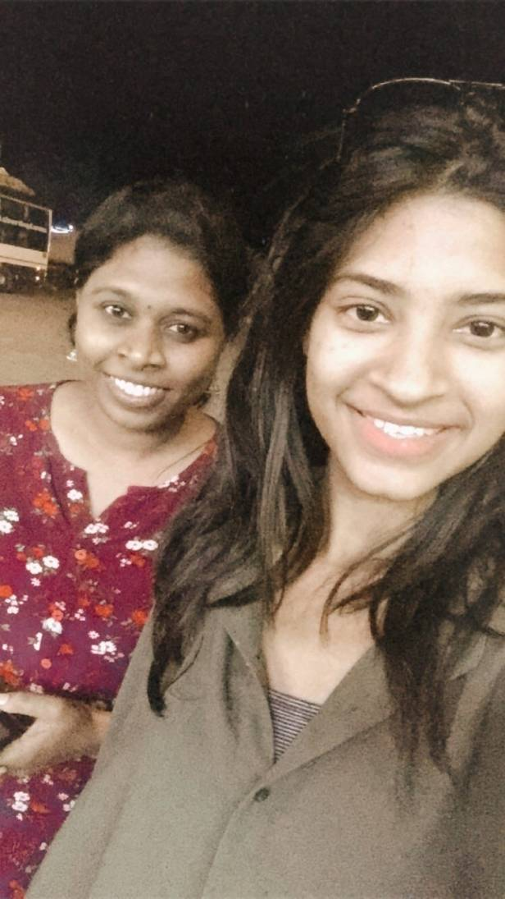
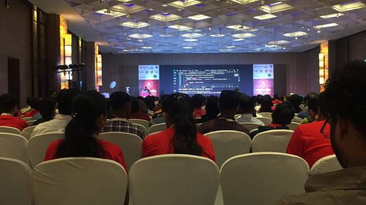
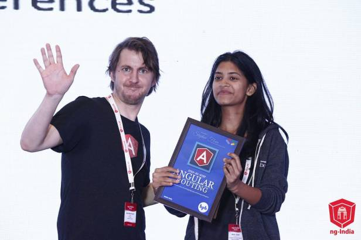
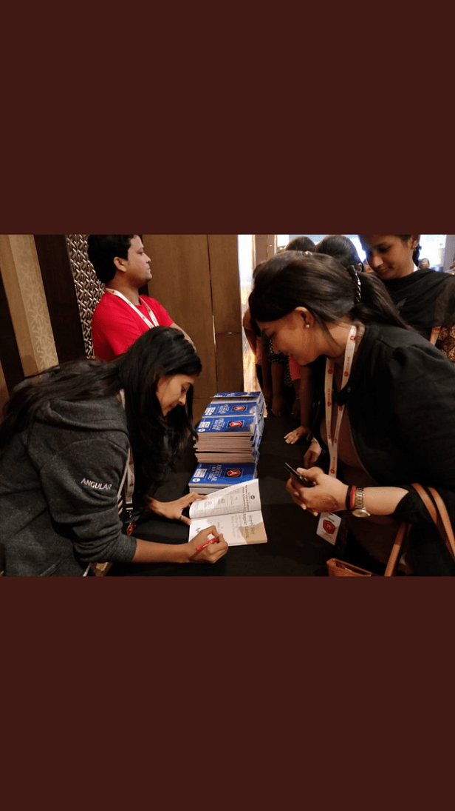
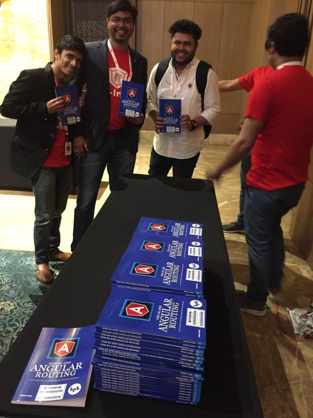


> Pretty sure you know why the blog post has visuals in the first 2–3 paragraphs, and then none! 🤷🏻‍♀️

It wouldn’t have been these many words in this blog post if it was not for the year 2020. Strangest year in my 24 years of living and I believe, the strangest for almost everybody, 2020 had its own way of teaching us stuff the hard way, it be losing our close ones, losing jobs, not having enough opportunity to distract ourselves from the monotonous at-home daily activities etc., city/country unrest, protests and what not!  
I know putting the blame on the year itself might not be justified, but let’s just do that to stay motivated for the upcoming year.

At first, I thought why go back and think through the whole year and pen it down but then I decided to definitely write about everything the year was for me, for people around me.

So as everybody would have had, I had huge plans for 2020, but the year didn’t really, so my year started with a very exciting phase as my US visa was just confirmed and I was all set for the trip in February, planning my talk, slides, but things went virtual 😀

Travel to Kerala for my talk at [Trivandrum TechCon](https://www.2020twenty.net/trivandrum/) was the first trip of the year in January and was a great start to the year.

trivandrum techcon

This was followed by fun sessions with fellow speakers at Kovalam beach

Boxing sessions at Kovalam beach

I love making friends from different cultures, professions, and upbringing, and in my journey, met Renjithi, a rocket scientist and an aspiring ISRO woman. Discussing tech, Malayali songs, challenges of working as a rocket scientist, conferences, speaking opportunities, etc. was a worthwhile journey of 6 hours.

Here is one picture to share from archives.

Bangalore to Trivandrum

After this came the first bad news of the year when the conference in Atlanta got cancelled few days before my travel date. But thankfully, this was followed by a great great news of me getting awarded the [**Google Developers Experts**](https://developers.google.com/community/experts) award on the basis of the technical contributions like writing blog posts sharing my Angular learning/expertise, speaking at events/meet ups/conferences etc.

I was building a website for an AI based education bot at work which materialised well so the things at work were pretty exciting as well. Now was when I started prepping for ngIndia 2020 and I was all set for building web components live on stage using Angular framework and then consuming them in React. So the time after work would go into building interesting custom components.

It was time for India’s Angular conference 2020, ngIndia which flies me to Gurgaon city from Bengaluru and here I was [**speaking about web components**](https://youtu.be/b0keOzkknuU)with fellow speakers from different professions, countries, core Angular team members.

The highlight, I must say, of the conference was where my books were distributed to developers attending the conference. Signing my book and sharing with people was an surreal experience.

The conference ended on a very successful note with so many attendees going back with so much learning.

It was time Covid was everywhere and things started closing down gradually, people running to their homes as MNCs started closing down until nobody knew when! People living in shared flats started suffering, people stuck abroad suffered, low wage earners suffered. Sudden Lockdown worsened the condition of many households financially, however I still think somehow this sudden lockdown did save the bad situation from worsening even more (I think!). Sad sad times for everybody with lost jobs, lost lives and what not!

Thankfully, I was doing two projects at the time when all this unrest was going on. So much work on my plate kept me sane and busy and as I always apply:

> “Work is the best antidote to sorrow.” — Sir Arthur Conan Doyle

Was still trying to focus on the positives happening around. Now was the time I took the best decision of the year, switching jobs! I was very happy with the work I was doing with @IBM, handling frontend building Angular projects in the UI Garage. Curious to expand my tech base, I was ready for new challenges and joined @The Dataworks, London, building the web using React framework. My job includes stuff not just frontend, but amazing things with Golang and Python too, and boy could I ask for more! I love the learning curve and the difficulty I face everyday with being `pixel perfect` and the new challenges, but I am sure it is all worthwhile.

May 2020 and the pool of technologies that I got myself into has just been amazing. Following was something I had never expected, lost two very close family members in a span of 2 days, one after the other, and this was just crazy. Realised for the first time how temporary life could be for one..and how important it is to just share everything we feel, do everything we want to without keeping it for later.

The best thing to happen mid this year was being awarded as a [**Microsoft MVP**](https://mvp.microsoft.com/en-us/PublicProfile/5003753)for contributions in developer technologies and such things were so motivating to keep going! I also did my website and finally got a domain for it this year.

#### Check it out: <http://unravelweb.dev/>

I read very few books this year but suddenly I started reading a lot on death, afterlife, [**Many lives, many masters**](https://www.amazon.in/Many-Lives-Masters-Prominent-Psychiatrist/dp/0749913789), to name one of the books.

With virtual conferences and events, things in community were very different now with no in person conversations that would be the real knowledge sharing otherwise. But yes, have to say, technology proved to be THE SOLUTION in everyy field this year!! Accepting the fact that some things are better in person, some professions are better when carried face to face, technology could at least provide the best alternative.

I was speaking at so many conferences and got into very hectic schedules with work, conferences, etc. Again, did I share I got to speak at the largest Angular conference, ngConf! Yeah couldn’t believe it myself but that happened yes! Imagine I’d be traveling for ngRome, ngPoland, ngConf if it was not for covid!!

I also was writing a text/code-based Angular course which we will soon see up live in coming days.

I will also list the events I spoke at this year in the end of the blog post and list the very few books I read too.  
Overall, I think, I have worked a lot this year, mainly in 2 directions, and have also understood the very importance of relationships and spending time with family, friends, because I do not want to regret later.   
I have also been hugely impacted with the city unrest as to be trying to understand the reason why so many protests had to occur. Was it the lack of information with the individuals causing the protests, was it the wrong decisions by the government, or was it the wrong timing of the decisions taken, or was it all just POLITICAL! I don’t know and I just decide to read more and know more, not just one side, but both to be able to decide and understand what exactly is going wrong to let this divide, protests etc. happen in our dear country, because it DOES impact US ALL in different ways, We are just too ignorant or at least I am to think that its not impacting us. But no more on this topic..

### Highlights:

* Building a text/code-based Angular Course (to be published soon)
* Switching jobs
* Google Developer Expert
* Microsoft MVP
* Foray into Golang ( I love it, as yet)
* Selling/Distributing an amazing number of copies of my book — [**Angular Routing**](https://www.amazon.com/Step-Step-Angular-Routing-client-side-dp-9388511662/dp/9388511662)
* And oh yes, my blog at a new domain — [**http://unravelweb.dev/**](http://unravelweb.dev/)

### Speaking at conferences/events:

* Trivandrum Techcon
* ngIndia 2020 — <https://youtu.be/b0keOzkknuU>
* ngConf Enterprise
* ngPoland
* ng Rome
* HackOn Hackathon <https://youtu.be/gpuMx8XOoQY>
* MS Howto — Turkey <https://youtu.be/QxuNXmGK-lo>
* Angular conference — c# corner <https://youtu.be/uKrZ4uK-JtU>
* Azure Virtual conference — Azure Static Sites [https://www.youtube.com/watch?v=JLh929RrmqA](https://youtu.be/vf49WIdfWQE)
* GDG Nagpur Workshop <https://youtu.be/LFF9hvY_9-4>
* AZConf Dev <https://youtu.be/eaEeSr9pwlU>
* Tech Webinar Nepal <https://youtu.be/eHHOgg-yI9Q>
* IWD India Summit 2020 <https://youtu.be/xzTu83cxo1Y>
* Angular Online — Deep Dive into Angular Router <https://youtu.be/ha7wX65jloI>
* MS Build Recap 2020 <https://youtu.be/lqYaLZjpmy4>
* Global Azure Virtual Conference — Angular on Azure <https://youtu.be/bFHuZdYiTP8>
* Angular Kenya <https://youtu.be/IFBCxdz0wVg>
* Angular Online Event — NG Poland <https://youtu.be/8NQCgmAQEdE>
* African Young Developers Hangout

### Reading:

* Creeds
* Father & Son Co.
* City of Girls
* Many lives, many masters
* Journey of Souls
* The Courage to be disliked
* The Mind of the Terrorist
* Deep Work
* Jonathon Livingston Seagull
* Clean Code
* Normal People
* The Road to Al-Qaeda
* The Woman Warrior
* The Age of Turbulence
* the intelligence trap
* for one more day
* Why we sleep
* Losing my Virginity

Happy 2021 everyone!

Nishu Goel, Engineer  
[*http://unravelweb.dev*](http://unravelweb.dev/)  
Email: *nishu0505@gmail.com*  
Github: [*github.com/nishugoel*](https://github.com/nishugoel)

