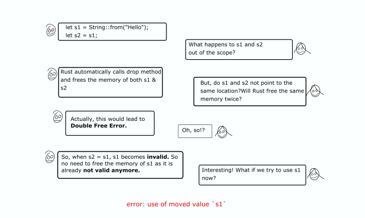


This is one of the memory safety bugs in Rust, which we will try to understand through a dialogue in this blog post.

```
let s1 = String::from("Hello");
let s2 = s1;
```



```
let s1 = String::from("Hello");  
let s2 = s1;println!("{}", s1);
```

> Error — *use of moved value*`s1`

Do share your understanding.

Thanks!

