
know what I mean?

nope, not another rant post.  
not to do with staying productive working from home.  
also not about travel nostalgia.

yeah enough mystery, right? **So in this post, I’ll**`briefly`**share a tip about the usage of logical operators in Javascript**and updated ways to use them in 2021.

quite unrelated to the title, ya? It’s actually not. you’ ll see why.

# TLDR; Using logical operators with assignment :

> 1) &&=
>
> 2) ||=
>
> 3) ??=

the blog post title?

=======================================

## Basic most way of using logical operators in Javascript

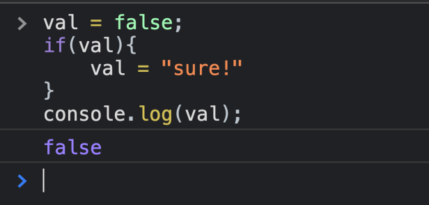
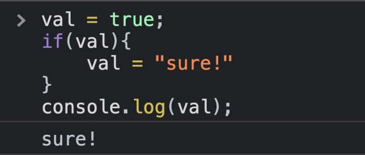

Now, let’s make it simpler.

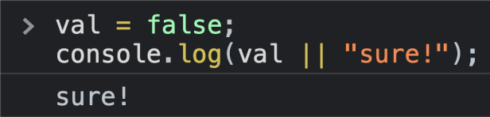

all simple so far?  
but did you know we could also assign using logical operators? let’s see.

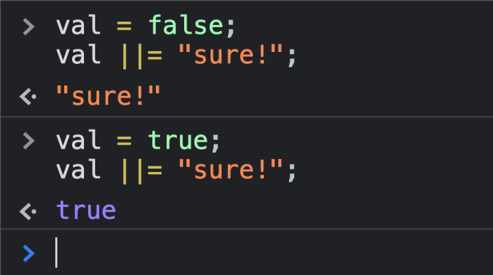

This is similar to how we have been using the numeric operators `+=` :-

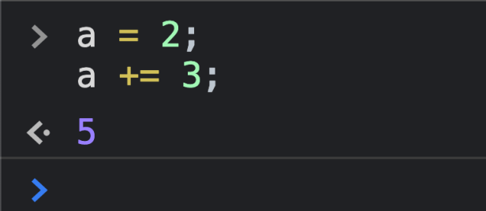

let’s see some more examples of assignments using logical operators.

## Using && operator

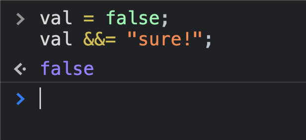
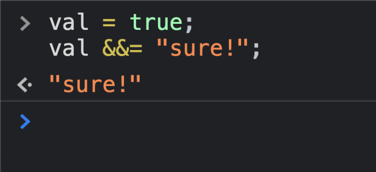

with `&&` operator, it prints the right hand side if ‘val’ is truthy, LHS otherwise.

## Using nullish coalescing operator

The nullish coalescing operator specifically checks for null or undefined, so if a variable is null or undefined, return an alternative, else the value in the variable.

***non-assignment usage***

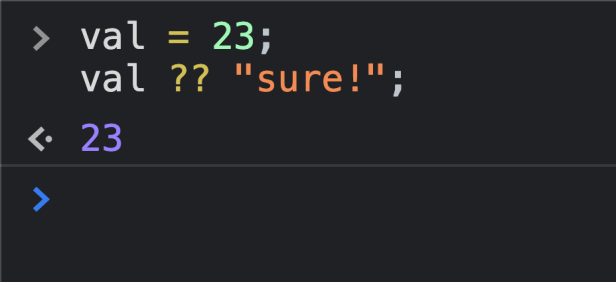
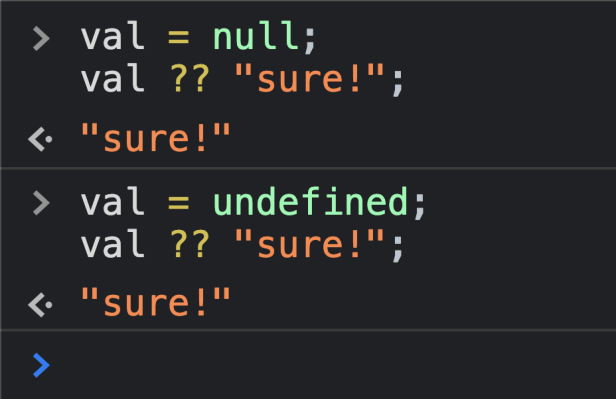

***with-assignment usage***

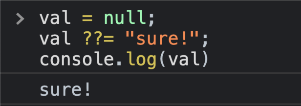
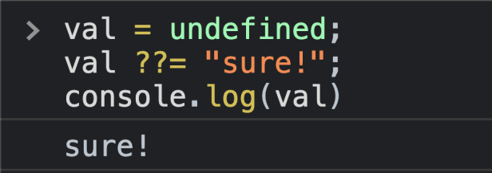
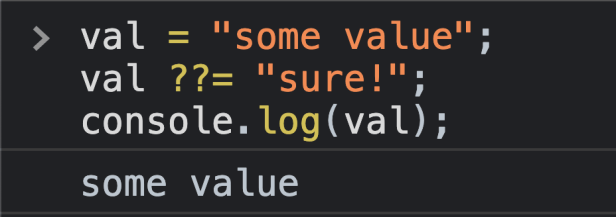

there we go with a small but helpful enhancement in this javascript feature.

oh also, remember?

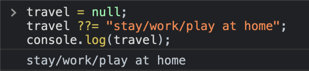

Goodbye! 🙂

