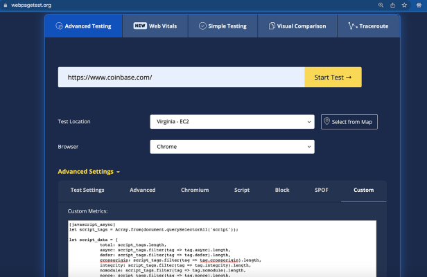
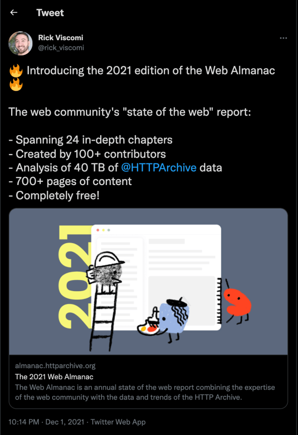
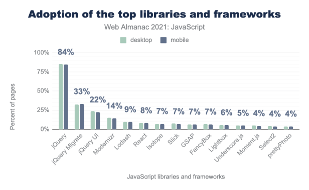
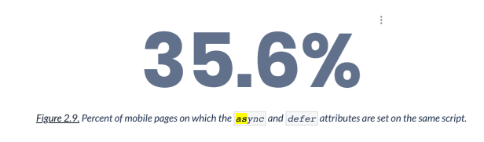
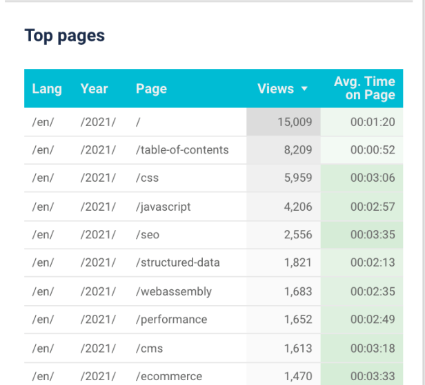


hi folks!  
This post comes after 4 months and I am grateful to my almost 1K Medium followers who still read my posts.  
The past months were quite a ride with all the work that I was busy with. Did you say, “but you weren’t writing!”? I was! Just not here on my personal medium blog.

So I took up a bigger challenge for myself (yes, open-source, of course) and with a better read for y’all. Yes, it’s a lot of content.

So, I authored the [**JavaScript chapter for the Web Almanac 2021**](https://almanac.httparchive.org/en/2021/javascript). To keep you up to speed, [The Web Almanac](https://almanac.httparchive.org/en/2021/) is:

> HTTP Archive’s annual state of the web report that combines the raw stats and trends of the HTTP Archive. It is backed by real data and trusted web experts. The 2021 edition is comprised of 24 chapters spanning aspects of page content, user experience, publishing, and distribution.

In simple terms, it shares a lot of statistics around what is being used, adopted, preferred on the web by the developer community. How are the features being used and if the way they are used, serve the sole idea of the introduction of that feature.

My participation started while I was exploring GitHub activities, and ended up coming across at the [Http Archive’s JavaScript repo for 2021](https://github.com/HTTPArchive/almanac.httparchive.org/issues/2141). I volunteered to author the chapter but ended up becoming the content team lead whose responsibility was not just analysing the data from the [**8 million websites**](https://almanac.httparchive.org/en/2021/methodology#websites) crawled and writing about it, BUT many other steps.

I’ll be honest that I was overwhelmed with the amount of work to do and get the chapter in its shape, but it was challenging and basically, lots of data (power)!

The phases (starting June 2021) in the complete chapter building involved:

1. Planning the content and preparing an outline.
2. Gathering the data and writing [custom metrics](https://github.com/HTTPArchive/legacy.httparchive.org/blob/master/custom_metrics/javascript.js) (in JavaScript). These were run during the crawl after the page was rendered in the browser.
3. July 1–31 is when the crawl took place.
4. Next was to analyse, [query the data](https://github.com/HTTPArchive/almanac.httparchive.org/tree/main/sql/2021/javascript) and save [the results to a sheet](https://docs.google.com/spreadsheets/d/1zU9rHpI3nC6jTz3xgN6w13afW7x34xAKBh2IPH-lVxk/edit?usp=sharing) which is the source of truth for all the content in the chapter. This step also involved ensuring that our custom metrics ran properly and output was expected (I have an interesting anecdote to share about this later).
5. Now started the draft writing phase based on the understanding formed after the data output. This was, as it seems, the most involving task in the whole process. Not only because there was loads to write but also because, you need to analyse as to why, for example, there is increase/decrease in the usage of one particular JavaScript feature.
6. Nope, doesn’t end there. This is where the review process starts where your reviewers help you frame sentences better for a common and easy understanding. They help you with forming the overall chapter better both content and usage wise.
7. Editing — This step was more about language improvements and obvious mistakes that should be removed.
8. To the moon. 🚀

In the next few paragraphs, I will share about the learnings and challenges at each step. The purpose of doing this is 1) to reflect how helpful and growing of an experience this was personally, 2) to help anybody who is considering writing the chapter in the coming years, 3) to point you the great resource (all JavaScript and more), if you haven’t already come across this ocean of information.

* The outline planning stage was super fun, full of research where we were all creative and thinking of putting in the best possible statistics and information. This involved the [newer JavaScript features based on the TC39 finished proposals](https://github.com/tc39/proposals/blob/master/finished-proposals.md) to the community. My fellow contributors helped me in the process of preparing the outline and brainstorming the content. [Pankaj Parkar](https://twitter.com/pankajparkar) was very helpful in this step suggesting ideas and possibilities.
* Writing custom metrics was based on the author’s understanding of what they plan to deliver through the chapter and what is the data that they need from the websites to showcase that. This involved thinking ahead on all what could be available from running queries on data, or something that needed to be captured after the page render.

For example, To check if the script tags use the async/defer attribute, there were two ways — 1) check initial page and look for scripts with these attributes — This did not require running a custom metric and could be simply attained by running a query on summary response table in the database.  
2) To write a custom metric to get the no. of script tags with async or defer attribute and then run a query to get this percentage.

<https://github.com/HTTPArchive/legacy.httparchive.org/blob/master/custom_metrics/javascript.js#L62>

[The results were different from each other.](https://almanac.httparchive.org/en/2021/javascript#async-and-defer) You’d wonder why:

> “This difference shows that many pages update these attributes dynamically after the document has already been loaded. For example, one website was found to include the following script….”

We used [**web page test**](https://webpagetest.org/) to run our custom metrics and ensure that’s what we are looking for from the crawl.

For example:

WebPageTest to run our script tag custom metric

One challenge faced with the custom metrics was specifically with the web component custom metric where we made a [mistake in the code ending up not getting correct results from the July Crawl. We fixed this for the next crawl](https://github.com/HTTPArchive/legacy.httparchive.org/pull/231) and the results in the chapter were, thus, delivered from the September crawl for this particular statistic.   
  
See the note here:  
  
<https://github.com/HTTPArchive/almanac.httparchive.org/blob/main/sql/2021/javascript/web_components_specs.sql>

* The next was analysing the crawl data. The queries were supposed to be written using BigQuery which was a good learning activity. We wrote the queries and saved the output to the result sheet. The analysts helped us with saving the data and creating the visuals for that. All the interactive charts and statistics.

Following queries were used to gather the data for the chapter.

<https://github.com/HTTPArchive/almanac.httparchive.org/tree/main/sql/2021/javascript>

The charts created from the query data were published both interactively and as images. Finally wrote the chapter in a doc, converted to markdown, added the figures to the chapter in a render-able format.

<https://github.com/HTTPArchive/almanac.httparchive.org/blob/main/src/content/en/2021/javascript.md>

The conversion of visuals to a format that adds caption, description, and interactive charts was definitely a lot of task after the writing the chapter but definitely worth it.

<https://almanac.httparchive.org/en/2021/javascript#javascript-requests-per-page>

[The chapter finally launched on December 1](https://twitter.com/rick_viscomi/status/1466085711396933634)after all the reviews, edits added, accommodated, and this definitely felt like an achievement.

The chapter was welcomed very well and got a lot of people talking. Especially with the following statistic which show the usage of jQuery still at 80%.

Credits: <https://almanac.httparchive.org/static/images/2021/javascript/js-libs-frameworks.png>

And the usage of async/defer statistic:   
[JavaScript (Web Almanac 2021)Pages using async/ defer / neither](https://docs.google.com/spreadsheets/d/1zU9rHpI3nC6jTz3xgN6w13afW7x34xAKBh2IPH-lVxk/edit#gid=2038121216)

Credits: <https://docs.google.com/spreadsheets/d/1zU9rHpI3nC6jTz3xgN6w13afW7x34xAKBh2IPH-lVxk/edit#gid=2038121216>

In the first week of publishing, it became the most popular chapter of the Web Almanac with more than 2K views already. You can view the 2021 Web Almanac analytics here:

<https://datastudio.google.com/s/gNBIUwcc8LE>

Some amazing statistics about this year’s Web Almanac are:

[7](https://github.com/HTTPArchive/almanac.httparchive.org/issues/2167) [months of work](https://github.com/HTTPArchive/almanac.httparchive.org/issues/2167)  
[736 queries and 48,218 lines of SQL](https://github.com/HTTPArchive/almanac.httparchive.org/tree/main/sql/2021)  
[24 chapters](https://almanac.httparchive.org/en/2021/table-of-contents)  
[112 contributors](https://almanac.httparchive.org/en/2021/contributors)  
[8M websites tested and 40 TB of data analysed](https://almanac.httparchive.org/en/2021/methodology)  
[Over 700 pages when saved to PDF](https://almanac.httparchive.org/static/pdfs/web_almanac_2021_en.pdf)

You can download this as an [**ebook**](https://almanac.httparchive.org/static/pdfs/web_almanac_2021_en.pdf) too.

You can already sign up to contribute to the next year’s report here. This could be as an author, reviewer, editor, and/or as an analyst.

<https://forms.gle/Bb2ZZj6Yw5RnJHbj8>

This is about what I was doing the past 4 months and what comes next is more detailed blog posts from me on the Web in general.

[Follow me on Twitter](https://twitter.com/TheNishuGoel) for more details and staying up-to-date.  
OR  
If you are not a Medium fan (maybe because of the paywall, or because of the hassle of going to incognito to open my posts),  
I have all the content also served on [my personal website](https://unravelweb.dev/), which is absolutely free, no paywall, no ads.

<https://unravelweb.dev/>

# Thank you!

