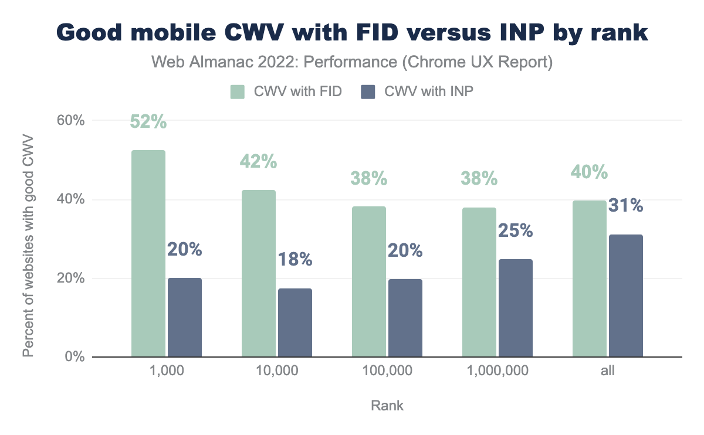
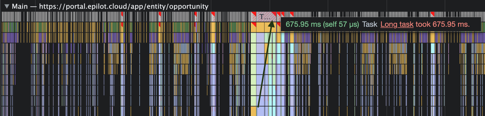
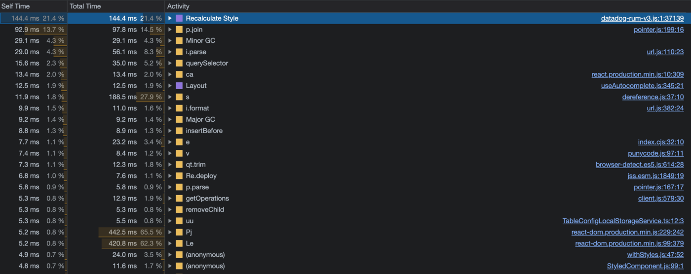


Imagine the scenario where you click on an element and expect a response but the element doesn’t seem like it was clicked and doesn’t respond, so you click again. Those two clicks however, when the response completes, lead to undoing the action you wanted. Ever happened with you? Sounds frustrating, doesn’t it?

This is the kind of experience, we as web engineers, cannot afford to give to the users. And there can be multiple reasons that could lead to this. If you regularly check the performance of your apps, you would have come across suggestions to code-split your application and reduce shipped JavaScript. In this post, we look at the causes of slow responsiveness of an application, how we could measure the slowness, and the approaches to improve it.

**TL;DR**  
Certain tasks on a user interaction can be blocking, giving the user a broken experience, and resulting in a low INP metric score.

Some ways to optimise it could be:

* keep tasks small and dedicated to what they should do.
* use Chrome’s scheduler API to schedule tasks for browser
* yield important tasks to the main thread

Let us first understand why a user interaction could be slow. When a user interacts with an element on the browser, the user agent takes that as one *task* and queues it in the list of tasks for the browser. This one task could take more time or less depending on the type of operation needed to be performed. Some tasks take longer resulting in the main thread being busy performing that and leading to the the other tasks being blocked in the meantime.

## Long tasks

A task is considered a long one if it goes beyond `50ms` to execute and `50ms` to respond, basically, more than `100ms`. A website which doesn’t have long tasks, is expected to respond within `100ms` with both the execution and response time on a user input, according to [**RAIL**](https://developers.google.com/web/fundamentals/performance/rail).


long task blocking user response

As per [data from Web Almanac](https://almanac.httparchive.org/en/2022/javascript#fig-34), it’s interesting to note that a median mobile page tends to have 19 long tasks.

Imagine the scenario where you click on an element and expect a response but the element doesn’t seem like it was clicked and doesn’t respond, so you click again. Those two clicks however, when the response completes, lead to undoing the action you wanted. Ever happened with you? Sounds frustrating, doesn’t it?

This is the kind of experience, we as web engineers, cannot afford to give to the users. And there can be multiple reasons that could lead to this. If you regularly check the performance of your apps, you would have come across suggestions to code-split your application and reduce shipped JavaScript. In this post, we look at the causes of slow responsiveness of an application, how we could measure the slowness, and the approaches to improve it.

**TL;DR**  
Certain tasks on a user interaction can be blocking, giving the user a broken experience, and resulting in a low INP metric score.

Some ways to optimise it could be:

* keep tasks small and dedicated to what they should do.
* use Chrome’s scheduler API to schedule tasks for browser
* yield important tasks to the main thread

Let us first understand why a user interaction could be slow. When a user interacts with an element on the browser, the user agent takes that as one *task* and queues it in the list of tasks for the browser. This one task could take more time or less depending on the type of operation needed to be performed. Some tasks take longer resulting in the main thread being busy performing that and leading to the the other tasks being blocked in the meantime.

## Long tasks

A task is considered a long one if it goes beyond `50ms` to execute and `50ms` to respond, basically, more than `100ms`. A website which doesn’t have long tasks, is expected to respond within `100ms` with both the execution and response time on a user input, according to [**RAIL**](https://developers.google.com/web/fundamentals/performance/rail).


long task blocking user response

As per [data from Web Almanac](https://almanac.httparchive.org/en/2022/javascript#fig-34), it’s interesting to note that a median mobile page tends to have 19 long tasks.

This is where [**INP**](http://web.dev/inp) comes into picture. INP is a responsiveness metric, stands for Interaction to next paint, which measures the time from when the user interacted with the page until when the next frame was actually visible on the page. A good INP measure is when the time between interaction and the feedback as a result of that interaction is the least.  
An interaction could mean events like `tap`, `click`, `keyUp`, `pointerdown` etc.

An interesting read [**here**](https://web.dev/inp/#:~:text=A%20note%20on%20how%20INP%20is%20calculated) on how’s INP actually measured .

> INP is calculated by observing all the interactions made with a page. The chosen value is then a [percentile](https://en.wikipedia.org/wiki/Percentile) of those interactions. A formula is then used to choose a high percentile value of those interactions.

The way we put web vital measures in a Good, Needs Improvement, Bad buckets, here is what a good and poor looks like for the INP metric.


To calculate the overall page responsiveness, an INP measure is calculated when the user navigates away from a page, and this comprises of all interactions like mouse events, keyboard events, touch/tap on a touchscreen device.

## FID / INP?

I remember analysing my websites, and always being satisfied with at least one metric of the three core web vitals 😀 — the First Input Delay. Would up my ego a bit that I am doing something good for sure. But if we look at the bigger picture, it is noticed that most websites have a good FID value, even when the responsiveness experience isn’t that great.  
And to address this, INP with a better measurement approach has been introduced. *INP doesn’t just measure the first interaction but all interactions on a page, unlike FID.* *Also, as the name says, INP measures the time until the next paint happens, unlike FID, that measures the time only until the processing happens.*

If we look at the INP scores on mobile devices, `55%` of websites have a good INP score, and `36%` need improvement. However, in case of FID, `92%` of websites having “good” FID. So, a better responsiveness measure with INP already brought down the “*good*” score.

It is also interesting to see that INP score tends to be inversely proportional to the popularity of a website, as [per data from the Performance chapter in web almanac](https://almanac.httparchive.org/en/2022/performance#inp-by-rank).

With a better approach to measure the responsiveness of a website with INP, it would make sense for developers to really start considering this metric as an important performance check, also with Google considering to replace FID with INP as one of the core web vitals.



When looking at the mobile experiences by site rank, `52%` of top 1K websites fall in the *good* category with `FID` metric, however only `20%` pass with good status with `INP` as a metric, and this is a huge difference hinting towards the need to really improve the overall responsiveness situation, *long tasks* being one of the things to solve.

## Can I track my website’s INP value?

One cool way to track our website’s interaction to next paint measure with real data from users is using the `web-vitals` library.

The library offers the `onINP` method that returns the type of event along with the INP value.

We could record this data and then receive it via some API or analytics provider to be able to understand the reasons behind the INP measure based on the real usage from field.

Something like this: 

```
import {onINP} from 'web-vitals';
onINP(({name, value, attribution}) => {
  console.log(name)
  console.log(value)
  console.log(attribution.eventType)
});
```

This gives us the measure of our INP and helps us understand further how we this interaction delay be improved.

This is how the general INP score looked like on websites as per the [data from Web almanac](https://almanac.httparchive.org/en/2022/javascript#fig-31).


## How do you find a long task in your application?

By now, we would know how the INP value is doing, and the next step right away would be to profile our app and see the improvement areas. To do this, we go straight to the performance profiler and identify the long tasks (ones exceeding the threshold of `50ms`).



As we can see, there are many long tasks leading to slower input response to the user, one such having a delay of `676ms`.

And as we dive deeper, it gives us some idea about the operations causing this to go up to `600ms` here:



Let us try to optimise one such long task now. There can be different approaches to improve long tasks, with one being breaking up your long tasks into smaller dedicated tasks.

For example, the long task from above which took `600ms`, was a blocking task for UI related updates, and thus would result in a broken experience for the users since they’d see a delayed response. What if the task still does exactly what it does but it is broken into multiple tasks with small operations, meaning:

* Task 1 — Only for querySelector step
* Task 2 — parse
* Task 3 — getOperations
* Task 4 — removeChild  
  and so on.

This would then allow us to inform the browser to NOT delay the `removeChild` step because of the time-taking `parse` step which takes around `5.8ms` only for some parsing. And thus, allowing the browser to give a faster visual feedback to the user without having to wait for the multiple expensive steps before that.

Informing the browser to perform a task which is more urgent than others can be called “yielding to the main thread”. One way to do that is using a Promise with a call to a `setTimeout` function:

```
function yieldToMain () {
  return new Promise(resolve => {
    setTimeout(resolve, 0);
  });
}
```

This *setTimeout* call will then ensure to run the dedicated step as a separate task prior to the other queued-up tasks. It depends then, how one would want to prioritise their tasks, and when yield exactly.  
In our long task example, it would make sense to yield to the main thread after we expect some user visual as a response. For instance, showing a `loading spinner` before the `parse` step, which would mean that now we already have some response for the user in `271ms` instead of the `600ms`.  
This is already something better as compared to before.

One more use case could be to only wanting to yield to the main thread and perform a crucial task, when we see that there is an action that the user is waiting for a response from. In this case, it would make sense to yield to the main thread only after knowing that some input is pending.  
And that’s where the API `isInputPending()` comes to the rescue.

## isInputPending

Facebook contributed the `isInputPending` API to chromium based browsers which tells the browser if there is a user input that is waiting for a response. This is useful to be able to respond quicker to such tasks that need a visual feedback.

Read more here 👇🏻

> [Breaking up long tasks](https://calendar.perfplanet.com/2022/breaking-up-long-tasks/)


<iframe class="wp-embedded-content" data-secret="of8UdvCvUj" frameborder="0" height="338" marginheight="0" marginwidth="0" sandbox="allow-scripts" scrolling="no" security="restricted" src="https://calendar.perfplanet.com/2022/breaking-up-long-tasks/embed/#?secret=of8UdvCvUj" style="position: absolute; clip: rect(1px, 1px, 1px, 1px);" title="“Breaking up long tasks” — Web Performance Calendar" width="600"></iframe>


Web performance calendar 2022

