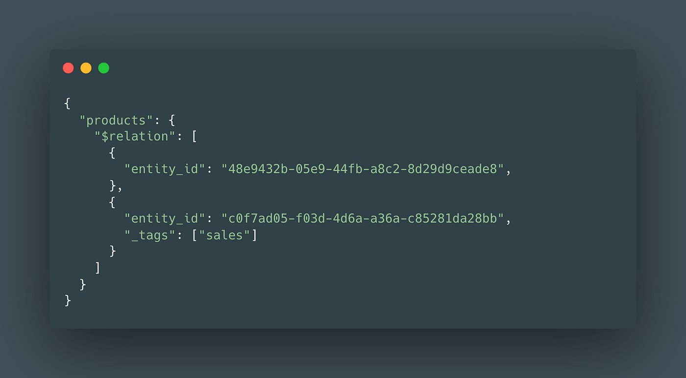
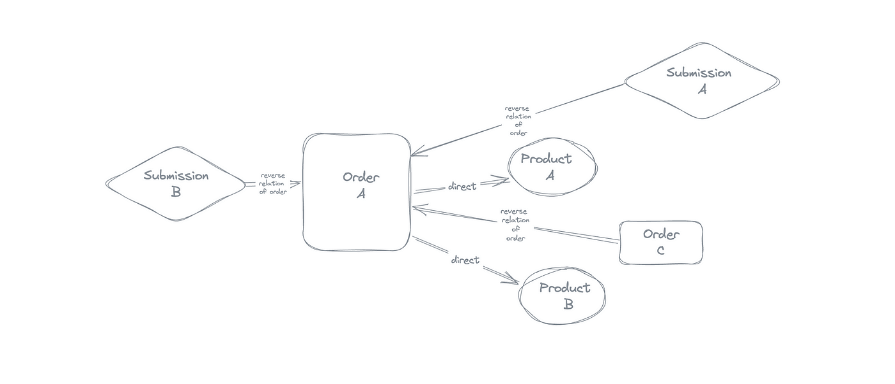
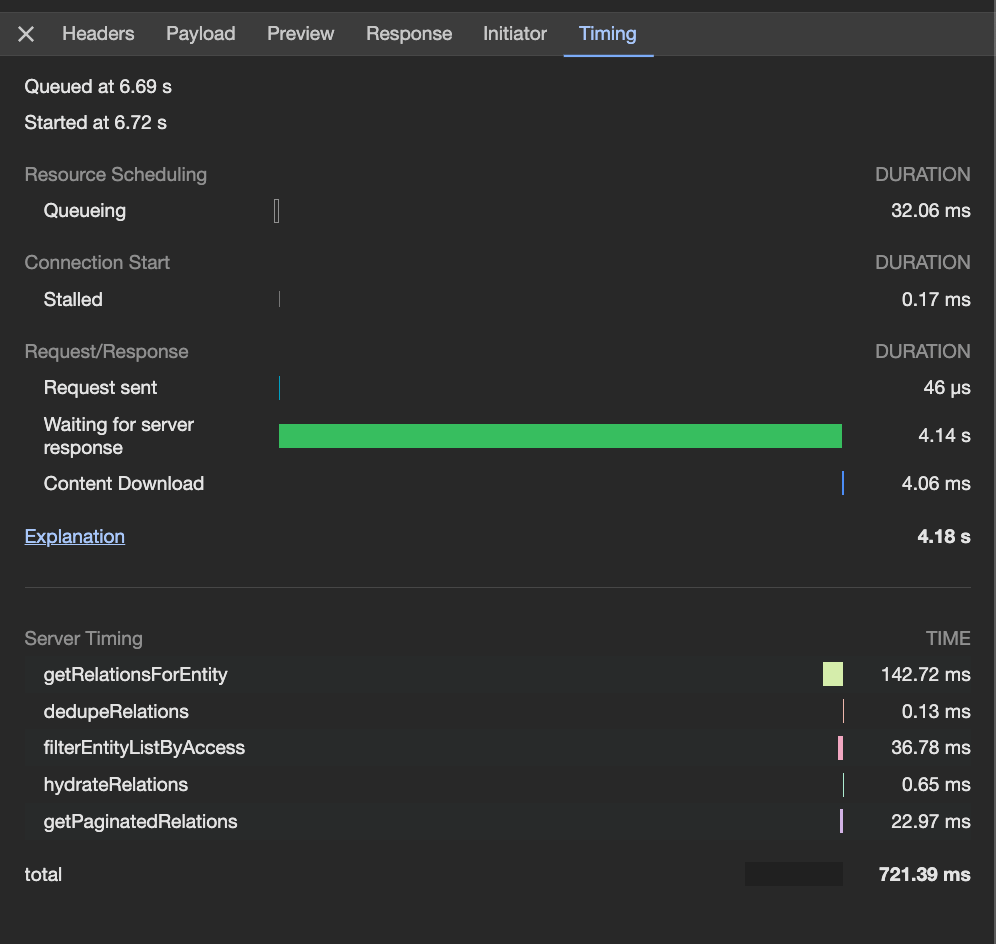
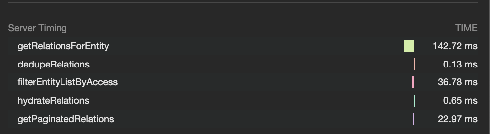
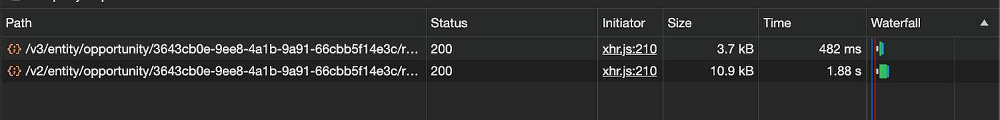
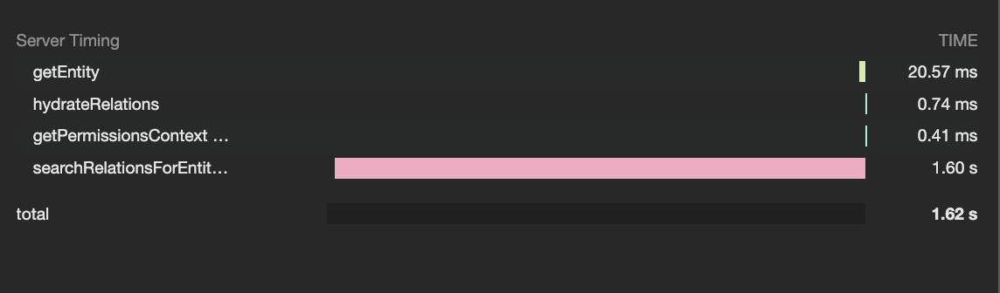
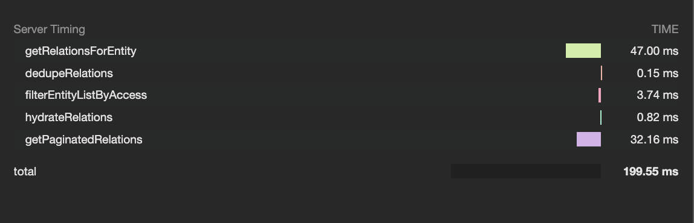
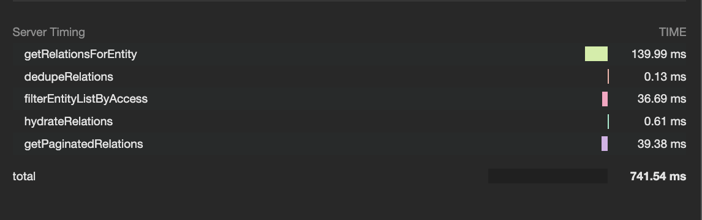


When working on the web, we all end up coming across situations where the experience for the user seems a bit janky. This happens either when you are dogfooding, or the users actually highlight facing that slowness, or you see that for yourself in your performance metrics or tools.

What one’d do in such a situation is look at the obvious things first: are the images loaded lazily? Is the bundle size too big? Is the main thread blocked? How is the performance panel recording looking? Is the data coming from the backend taking more time than it should?

If it’s one of the first problems, we’d fire up our favorite devtools and try to find out the root cause. If it’s the data being slow, we could see how long that is taking in the network requests duration. And, if it does end up being slow from the backend, the next step would be to dive into some logs and checking what piece of code in the request endpoint takes the time, or embedding some performance information in the response, or using other performance tools etc.

We had a similar situation at [epilot](https://epilot.cloud/) where we use [Elasticsearch](https://www.elastic.co/) to look for all related products of an order for example, and also all the other entities the order itself might be a relation to.

This meant, looking for direct relations of the order but also the reverse relations of that order.

Now in the Elasticsearch world, this meant:

1. Getting the list of related products of the order.
2. Searching through the documents in elasticsearch for all those related IDs.
3. Also, searching all other docs for having this one order as a relation to this (the reverse relation example, I shared above).
4. Finally returning all the found relations.



Showcasing two products as relations of an order



Entities and relationships

This worked great for the first few years and got us exactly what we needed quickly. However, as we scaled, the amount of documents indexed in ES increased too, and that meant, the *step 3* above started getting expensive and slow! The logic was to look for an entity ID in all the indexed documents and find if it is a relation or not. For orders with a lot of products, the endpoint would respond in seconds.

We had to fix the logic/ update the design asap.

The first solution was to update the ES query to make it more specific about what is being looked up, and then check if it improved with that query change and how the results looked for the entities with many relations. This meant looking into a crazy amount of [Cloudwatch](https://aws.amazon.com/cloudwatch/) logs and looking at the total time taken and if it was any better.

We made a change to [search query to be an IDs specific query](https://www.elastic.co/guide/en/elasticsearch/reference/current/query-dsl-ids-query.html) which would look through only the IDs in the indexed docs, and not through all the fields in those ES documents.

```
GET /_search
{
  "query": {
    "ids" : {
      "values" : ["1", "4", "100"]
    }
  }
}
```

The expectation was this would completely solve the problem and be super quick. This wasn’t the case unfortunately.

What we were missing was to see which part of the code was really adding to the time taken by the endpoint. We needed to observe the different steps in the process and see all the sections where the time taken could be reduced. We needed to see if it was really ES that was the culprit.

This is where *Server-Timing API* came into picture. Something that would break down the request into pieces and give us an idea about what’s expensive. The API allowed to pass the timings specific to a request from the backend to the browser. This meant that we could now see in the network requests, how the response times looked like, which part of the function took more time and so on.

To support this, we need to send a `Server-Timing` response header from the backend and time the methods that we needed. Something like this:

```
HTTP/1.1 200 OK

Server-Timing: db;dur=53, app;dur=47.2
```

The Server-Timing header can send three bits of information:

1. *metric name*
2. *duration*
3. *description of the metric*

In the above example:  
`db` — metric name  
`dur=53` — the time in milliseconds the `db` metric took (This is for instance, the time to fetch some data from the Database)  
`app` — another metric name and `dur=47.2` being the time taken for the same.

The header can take multiple metrics separated by commas delivering great information and is super lightweight. Although it is recommended to keep the metric names as small as possible.

An example of what the returned Server-Timing header looks like:

```
db; dur=142.715967; desc="getRelationsForEntity",flt; 
dur=36.777609; desc="filterEntityListByAccess",pgn; 
dur=22.96549; desc="getPaginatedRelations",hyd; 
dur=0.64605; desc="hydrateRelations",ddp; 
dur=0.13311699999999999; desc="dedupeRelations",total; dur=721.388338
```

And this information then translates into a more visual and helpful view as a part of the network timings tab of the request OR available via the [PerformanceServerTiming](https://developer.mozilla.org/en-US/docs/Web/API/PerformanceServerTiming) interface.

To access the three available properties, they correspond in the [PerformanceServerTiming](https://developer.mozilla.org/en-US/docs/Web/API/PerformanceServerTiming) as:

* *“name”* -> [PerformanceServerTiming.name](https://developer.mozilla.org/en-US/docs/Web/API/PerformanceServerTiming/name)
* *“dur”* -> [PerformanceServerTiming.duration](https://developer.mozilla.org/en-US/docs/Web/API/PerformanceServerTiming/duration)
* *“desc”* -> [PerformanceServerTiming.description](https://developer.mozilla.org/en-US/docs/Web/API/PerformanceServerTiming/description)

Here’s the [working draft](https://www.w3.org/TR/server-timing/) with more information.



Timings tab to see server response timings

*These are not available as a series of timings as such and just simple metrics and therefore, do not show in a waterfall pattern.*

This means we can now tackle both the frontend performance problems and the backend slowness problems all in one place. No jumping to the logs to find a response was slow or heading backing again to the devtools to find the frontend problem.

We could also read the data now available using the navigation (`PerformanceNavigationTiming`) and resource timing (`PerformanceResourceTiming`) APIs and send it our analytic tools to create metrics/monitors.

```
const performanceObserver = new PerformanceObserver((list) => {
  for (const entry of list.getEntries()) {
    log('Server Timing', entry.serverTiming);
  }
});

performanceObserver.observe({type: 'navigation', buffered: true});
```

Below is one of the examples from a method taking different amounts of time at different steps in the request. We will set up together the whole setting up and measuring the server response times later in this article.



Server response timings for a request endpoint in Browser devtools

This was especially helpful for the Elasticsearch example that I shared earlier as we needed to know which change was improving what part of the implementation and if it was moving us closer to improved response times. The Server-Timing header does not directly improve the timings but helps find out what could be worked towards.

The uniqueness of the API is that its super flexible and allows the server to communicate important information to the browser, even other than the server timings. It would be amazing to have this supported on Safari as well, which currently lacks the API support.

### Coming back to how we came down to the API response in 400ms seconds as compared to `1.8s earlier`



These are the two versions of the API. When we measured the performance with server-timings on the ES implementation after switching to the IDs search query on Elasticsearch, the performance seemed to be taking all the time, especially on this function `searchRelationsForEntity` .



Server timing indicating huge time taken by method `searchRelationsForEntity`

Now we knew this was to do with ES but where exactly. We timed specifics inside this method.

On measuring further, it was `entitySearch.searchEntities` that was taking up the most time so we needed to find a solution that would not go through all the ES documents at all to get the relation entities.

This is where changing the design made sense, and we moved to a graph table design with Dynamo, which would store all the relationships as mappings, and return all the entity IDs whether as `direct` relations or `reverse`.

Now we could choose if we wanted to search ES with all the IDs that we have or just batch get the entities from the db, and support pagination (this was an added advantage with ES) etc. separately.

Now, this complete dynamo approach saved us looking through all the indexed documents for the IDs that we need, and also cut some slack on Elasticsearch which would have this unnecessary load, eventually affecting other straightforward searches as well.

This is how the server timings looked with the DynamoDB approach:



Server timing indicating reduced times after switching to Dynamo to fetch entity relations

This was an amazing improvement, clearly visible with this significant performance information right in the browser devtools for us. This also ended up helping improve the code in general, to gain some more milliseconds by refactoring, and using performant ways to filter/hydrate/paginate things etc.We love to see the output of what’s in the works, and this was a great example to look at and feel a sense of achievement for.

### ***Implementation of Server-Timing as a middleware for AWS Lambda***

Now if you look up the existence of libraries supporting server-timing header, there are so many but most of them for *Express* and *NodeJS*.

* [server-timing](https://www.npmjs.com/package/server-timing)
* [server-timings](https://www.npmjs.com/package/server-timings) etc.

We needed to create one for the serverless use case which could be used for AWS Lambda, lets say to use with [middy](https://github.com/middyjs/middy) for example.

#### Step 1. Create a `withServerTimings()` middleware to use for AWS lambda

```
import middy from '@middy/core';
import * as Lambda from 'aws-lambda';

export const withServerTimings = () => {

  return {
    // add Server-Timing header to response
    after: (handler: middy.Request) => {
      const response = handler.response as Lambda.APIGatewayProxyStructuredResultV2;
      try {
        const headers: unknown[] = [];
        /**
          This is where the headers with different metrics are be saved
          and retrieved from
        */
        const timings = getServerTimingHeader(headers);
        response.headers = {
          ...response.headers,
          'Server-Timing': timings,
        };
      } catch (e) {
        Log.debug(`Middleware Error: Could not record server timings`, e);
      }
    },
  };
};
```

This creates a usable `withServerTimings()` middleware to then be used as:

#### **Step 2. Apply the middleware to the request handler**

```
return middy(handler)
  .use(...)
  .use(withCors())
  .use(withServerTimings())
  .use(...)
```

This already ensures that your backend will now be sending a `Server-Timing` header in the request endpoints.

Next step would be to actually time our operations and store them as a common timing variable which can then be sent to the `getServerTimingHeader` method for example.

#### **Step 3. Implement timing for your methods**

```
const times = new Map<string, Record<string, unknown>>();

// starting the timer on a method
const startTimer = (name: string, description?: string) => {
  times.set(name, {
    name,
    description: description || '',
    startTime: process.hrtime(),
  });
};

// ending the timer and recording the duration of the method
const endTimer = (name: string, description?: string) => {
  const timeObj = times.get(name);
  if (!timeObj) {
    return console.warn(`No such name ${name}`);
  }

  const duration = process.hrtime(timeObj.startTime as [number, number]);
  const value = duration[0] * 1e3 + duration[1] * 1e-6;

  timeObj.value = value;
  times.delete(name);
  return timeObj;
};

// finally setting the metric value received from endTimer object
const metric =
  typeof description !== 'string' || !description
    ? `${name}; dur=${dur ?? 0}`
    : `${name}; dur=${dur}; desc="${description}"`;
```

This would then be used as:

#### **Step 4. Usage of timers of the methods**

```
startTime('db', 'getRelationsForEntity');
const relations = await getRelationsForEntity({
  ...
});
endTime('db', 'getRelationsForEntity');
  .
  .
  .
startTime('pgn', 'getPaginatedRelations');
const { relations: paginatedRelations, hits } = getPaginatedRelations({
  ...
});

endTime('pgn', 'getPaginatedRelations');
```

And there we go, we will have the timed methods and the server headers looking like:

```
db; dur=139.99; desc="getRelationsForEntity",flt; dur=36.68; desc="filterEntityListByAccess",
pgn; dur=39.37; desc="getPaginatedRelations",hyd; dur=0.61;
desc="hydrateRelations",ddp; dur=0.130; desc="dedupeRelations",
total; dur=741.53
```



**Visual representation of the server-timing headers**

All the timing implementation and setting up the middleware can be a hassle, and should be a one-time job. I created a package out of this implementation called `lambda-server-timing`:

* **[lambda-server-timing](https://www.npmjs.com/package/lambda-server-timing)** (npmjs.com)
* **[GitHub – NishuGoel/lambda-server-timing](https://github.com/NishuGoel/lambda-server-timing)** (github.om)

* `withServerTimings` to use a middleware
* `startTime` to start measuring a function/set of functions
* `endTime` to end the timing of the function/set of functions and get the metric set.

```
import {withServerTimings, startTime, endTime } from 'lambda-server-timing';
```

Let’s time our functions down!

References

* [Working draft](https://www.w3.org/TR/server-timing/)
* [MDN Server Timing](https://developer.mozilla.org/en-US/docs/Web/HTTP/Headers/Server-Timing)
* [Navigation Timing](https://www.w3.org/TR/navigation-timing/)
* [Resource Timing](https://www.w3.org/TR/resource-timing/)

