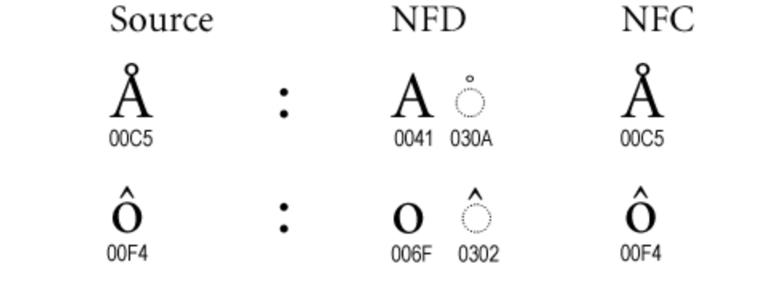


I implemented search and filtering for entities on our product at epilot. The users were heavily using the feature, however, a unique issue surfaced: difficulties in filtering file names containing diacritical marks like umlauts (`Äpfel`, `über`, `schön`, etc.).

Intrigued, I delved into the logic to investigate. Initially, everything seemed in order. For instance, a file named “blöb” was saved precisely as “blöb” — no bizarre encoding alterations were apparent.

Can you spot any difference between “blöb” and “blöb”?

This time instead of typing the word in the search bar, I copied it from the uploaded and saved filename, and and voilà, the search functioned perfectly! 🤯. This definitely meant the file name was subtly altered upon upload, hinting at a background encoding transformation.

So, as anyone would, I employed the power of `encodeURIComponent` to see for myself what really was different.

There it was! The different types of encoding forms that led to this. Now you might be wondering (*I was wondering too!*):

*As if worrying about encoding wasn’t enough, now we’ve got to stress over its different types too 🤦‍♀ and wait, its 2024, and we are still grappling with Unicode character encoding problems?*

The culprits in this case were these two contrasting encoding types: `%C3%BC` and `%CC%88`, leading to the search malfunction. This is a well-known issue with NFD/NFC encoding forms.  
There is a detailed explanation [here](https://unicode.org/reports/tr15/#Norm_Forms).

*Now imagine explaining this technical jargon to a user!*😃  
  
To fix it, I aligned the encoding type of the searched filename with that of the saved filename.  
On **MacOS**, the encoding was NFD (for ö: 111 + 776), whereas on **Linux**, it switched to NFC (ö: 246).  
  
**The solution?**  
  
– Post-upload, before saving the file as an entity, I applied `.normalize()` to the filename, ensuring it was uniformly searchable.  
  
– Additionally, as a cleanup step — to write a migration script to normalize the names of all existing files with non-ASCII characters.  
  
A simple string normalise proved effective in this case. ✅  
Read more about `String.prototype.normalize()` [here](https://developer.mozilla.org/en-US/docs/Web/JavaScript/Reference/Global_Objects/String/normalize#canonical_equivalence_normalization). There is also a specific normalization option to pass to ensure canonically equivalent normalization — for example: `string.normalize("NFC")`  
  
Here’s a visual representation of the problem with the solution output:

<https://drive.google.com/file/d/1Jkp8ye47iRfDoeTaMQkkskY_BTHegj_D/view>

<video controls="" src="https://drive.google.com/file/d/1Jkp8ye47iRfDoeTaMQkkskY_BTHegj_D/view"></video>

Hope it helps!

