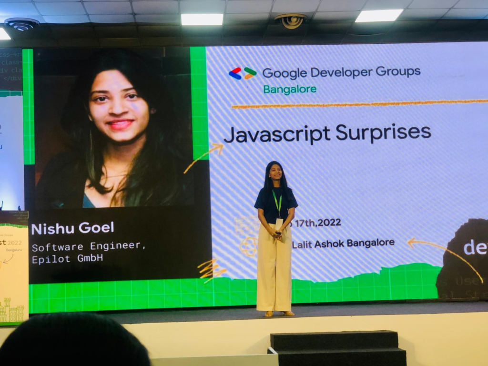


#### Most relevant

* [WEB EXPO – Prague – May 29](https://slideslive.com/39021004/breaking-down-long-tasks)
* [Perf now, Amsterdam – November 2023](https://youtu.be/2djPW7us9VI?si=cBJHhwaVRgQ3FBvJ)
* [Web Directions, Sydney – October 2023](https://webdirections.org/summit/)

#### Recent

* [Devfest Pisa](https://devfest.gdgpisa.it/)
* [iJS London](https://javascript-conference.com/london/)
* [JSPoland](https://jspoland.pl/speaker/nishu-goel)
* [Devfest Craiova, Romãnia](https://gdg.community.dev/events/details/google-gdg-craiova-presents-devfest-craiova-2022/)   
  Find the recording here 👇🏻

<iframe allow="accelerometer; autoplay; clipboard-write; encrypted-media; gyroscope; picture-in-picture; web-share" allowfullscreen="" frameborder="0" height="422" referrerpolicy="strict-origin-when-cross-origin" src="https://www.youtube.com/embed/_DY4sTCugkU?feature=oembed" title="Nishu Goel - JavaScript Surprises" width="750"></iframe>

* [Devfest Bengaluru, India](https://gdg.community.dev/events/details/google-gdg-bangalore-presents-devfest-bangalore-2022/)

Devfest Bengaluru

* [ngIndia 2022 – microFrontends](https://www.ng-ind.com/)  
  Find the recording here 👇🏻

<iframe allow="accelerometer; autoplay; clipboard-write; encrypted-media; gyroscope; picture-in-picture; web-share" allowfullscreen="" frameborder="0" height="422" referrerpolicy="strict-origin-when-cross-origin" src="https://www.youtube.com/embed/ydCCndGRo-g?feature=oembed" title="ng-India 2022 | Build your MFE 🤔 from zero by Nishu Goel" width="750"></iframe>


